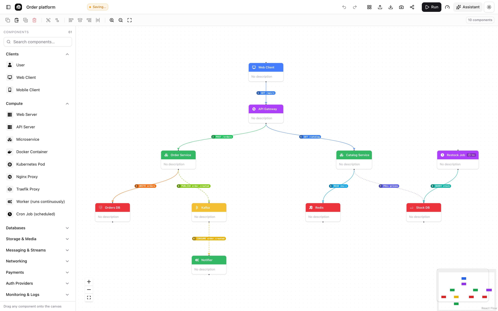
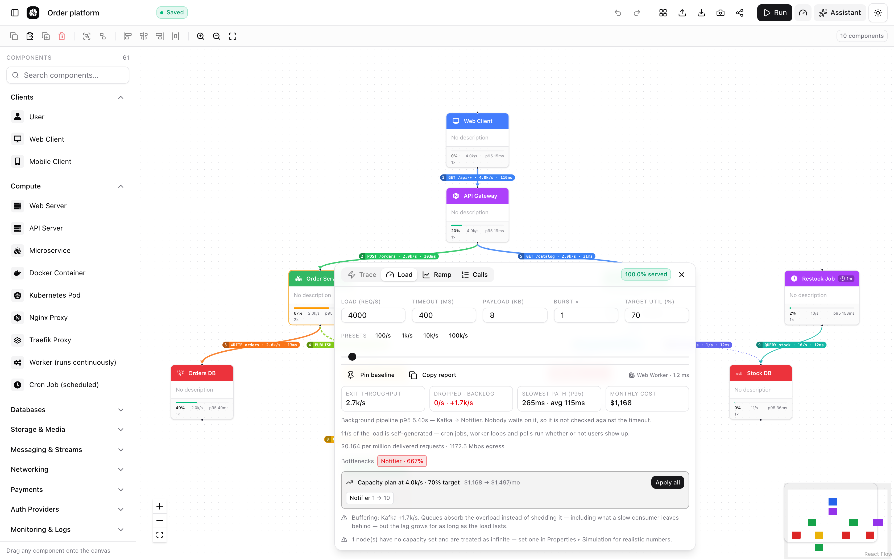
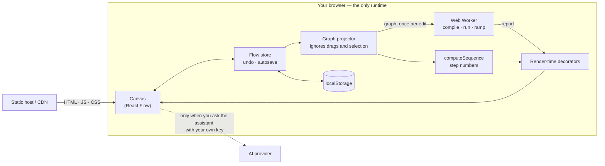

<div align="center">

# Nautilus 🐚

**Design a system, number every request in it, then push traffic through it until something breaks — all in your browser.**

No accounts. No backend. No lock-in.

[](https://github.com/Somilg11/nautilus/actions/workflows/ci.yml)
[](LICENSE)


[](CONTRIBUTING.md)

[Live app](https://nautilusss.vercel.app) ·
[Documentation](https://nautilusss.vercel.app/docs) ·
[Features](docs/FEATURES.md) ·
[Architecture](docs/ARCHITECTURE.md) ·
[Self-hosting](docs/SELF_HOSTING.md) ·
[Contributing](CONTRIBUTING.md)



</div>

---

## What it is

Most architecture diagrams are pictures. A Nautilus diagram is a **directed graph
with a request model on every connection and a capacity model on every
component**, which is what lets the tool answer questions a drawing cannot:

- **Which request goes where, and in what order?** Every connection is a
  numbered request — `4 PUBLISH order.created`, `13 POLL users every 30s`.
- **Who starts work on their own?** Cron jobs, worker loops and pollers are
  first-class, and their load is there at 3am with nobody online.
- **Where does this design stop working?** Push traffic through it and read off
  the bottleneck, the backlog, the p95 and the monthly bill.

Everything runs on the visitor's machine. The deployed site serves static files
and nothing else: there is no API, no database, no telemetry, and no environment
variable to set.

## Highlights

| | |
| --- | --- |
| **Numbered request flow** | 13 operations (`GET` `POST` `PUT` `PATCH` `DELETE` `CALL` `READ` `WRITE` `QUERY` `PUBLISH` `EVENT` `CONSUME` `POLL`) with an endpoint or topic, timeout, call order, traffic share and fan-out. Unlabelled connections are inferred from what they join. |
| **Trace** | Replays the numbered requests one at a time with play, pause, step back and forward, click-to-jump and 0.5×–4× speed. |
| **Cron, workers, polling** | A component can fire on a schedule or loop on every replica; a connection can poll on a timer. Reported separately from user traffic. |
| **Load playground** | Capacity, replicas, latency, error rate, cache hit ratio and price per node. Live utilisation, queue-inflated latency, drops, queue backlog, consumer lag and ranked bottlenecks. |
| **Capacity & cost** | Replica counts sized to a target utilisation (`Payment Service 8 → 90`), the monthly bill that implies, and cost per million requests. One click to apply. |
| **Load ramp** | Sweeps from zero and plots offered against delivered. The knee is where the design gives out; the panel also names the load at which p95 first breaches your budget. |
| **Failure injection** | Take a node out and see which paths die and what the success rate becomes. Pin a baseline to see every change as a delta. |
| **In-browser engine** | The load model runs in a Web Worker: compiled once per edit, re-run with parameters only, one run in flight at a time. |
| **Large diagrams** | Off-screen elements are not mounted, unreadable badges are hidden, and decorative effects switch off automatically on big diagrams and low-end devices. |
| **Component library** | 60+ draggable components across clients, compute, databases, storage, messaging, networking, payments, auth, monitoring and cloud providers. |
| **Templates** | Netflix, Uber, WhatsApp, Instagram, YouTube, Spotify, Zomato, three-tier and microservices — each modelled to serve its own rated load. |
| **AI assistant** | Bring your own OpenAI, Gemini, Claude or Groq key. It sees your canvas, and nothing it generates is applied without your say-so. |
| **Sharing** | JSON export and import, PNG export, self-contained share links, and a Markdown capacity report for design docs and pull requests. |
| **Runs anywhere** | Vercel, any Node host, a static CDN, one `npx` command, or a packaged desktop app. |

## Quick start

Use it right now at **[nautilusss.vercel.app](https://nautilusss.vercel.app)**, or
run it yourself:

```bash
git clone https://github.com/Somilg11/nautilus.git
cd nautilus
npm install
npm run dev          # http://localhost:3000
```

Requires **Node.js 20+**. There is nothing to configure.

<details>
<summary><strong>Other ways to run it</strong></summary>

```bash
# One command: builds if needed, starts a local server, opens your browser
npx github:Somilg11/nautilus
npx github:Somilg11/nautilus --port 4000 --no-open

# Native window (Electron shell around the same app)
npm run desktop
npm run desktop:build     # .dmg / .exe / AppImage

# Production server
npm run build && npm start
```

Docker, static export and reverse-proxy setups are covered in
[docs/SELF_HOSTING.md](docs/SELF_HOSTING.md).

</details>

### A two-minute tour

1. Open `/dashboard`, then **Templates ▸ Microservices Architecture**.
2. Read the badges: each connection shows its step number, operation and target.
3. Press **Run** (▶) to replay the requests in order; open the **Calls** tab for
   the full list with what triggers each one.
4. Press the **gauge** button to open the load playground, then drag the load
   slider until a node turns red.
5. Open the **Ramp** tab to see where the design gives out, and apply the
   capacity plan to move the knee.
6. Double-click any connection to change what it does.



*The load playground at 4,000 req/s. The notifier cannot keep up, so nothing is
dropped — Kafka's backlog grows at 1.7k/s, and the plan says ten consumers
would clear it for about $330 a month more.*

## How it works



- **The document** is `{ name, nodes, edges, sim }` — plain JSON, validated on
  every way in (import, share link, storage, AI output).
- **The graph projector** hands the simulators the same object until something
  structural changes, so dragging a node never re-runs anything.
- **`computeSequence`** numbers every hop: depth-first through the calls a
  handler waits on, hand-offs deferred until the request that caused them has
  finished, self-starting flows last.
- **The load engine** compiles the graph into index-addressed arrays inside a
  Web Worker, then makes one pass in dependency order per run with an M/M/1
  queueing approximation. A slider drag sends five numbers, not the diagram.
- **Decorators** merge results into nodes and edges at render time only, so
  simulation state never reaches undo history, autosave, exports or share links.

The full write-up, including the maths, is in
[docs/ARCHITECTURE.md](docs/ARCHITECTURE.md).

## The file format

A diagram is one JSON object. Hand-written and script-generated files are safe
to load: unknown fields are dropped and out-of-range values are clamped.

```jsonc
{
  "name": "Orders",
  "nodes": [
    {
      "id": "orders",
      "type": "nautilusNode",
      "position": { "x": 120, "y": 160 },
      "data": {
        "label": "Order Service",
        "icon": "microservice",
        "color": "green",
        "sim": { "capacity": 1500, "replicas": 6, "latencyMs": 45, "costPerHour": 0.1 }
      }
    },
    {
      "id": "recon",
      "type": "nautilusNode",
      "position": { "x": 420, "y": 160 },
      "data": {
        "label": "Reconciliation Job",
        "icon": "cron",
        "sim": { "capacity": 500, "schedule": { "kind": "cron", "everyMs": 300000, "batch": 200 } }
      }
    }
  ],
  "edges": [
    {
      "id": "e1",
      "source": "orders",
      "target": "kafka",
      "data": { "flow": { "op": "PUBLISH", "path": "order.created" }, "sim": { "share": 0.8 } }
    },
    {
      "id": "e2",
      "source": "recon",
      "target": "orders-db",
      "data": { "flow": { "op": "QUERY", "path": "orders (pending)", "timeoutMs": 2000 } }
    }
  ],
  "sim": { "requestsPerSecond": 8000, "timeoutMs": 400, "targetUtilization": 0.7, "burstFactor": 2 }
}
```

Every field is documented in
[docs/FEATURES.md](docs/FEATURES.md#the-json-format).

## Performance

Measured in headless Chrome against a production build, with 4× CPU throttling,
on a 336-node / 611-connection diagram: one node dragged through 60 pointer
moves at the same zoom level. "Before" is the last commit prior to the
request-model work.

| Scenario | Before | Now |
| --- | --- | --- |
| Drag, load playground open — wall time | 12.7 s | 4.2 s |
| Drag, load playground open — script time | 10.3 s | 1.6 s |
| Drag, load playground closed — wall time | 6.9 s | 3.8 s |
| Drag, load playground closed — script time | 4.5 s | 1.4 s |
| One load run plus 24-point ramp, in the worker | — | 1–2 ms on the microservices template |

Where the time went, and what replaced it:

| Was | Now |
| --- | --- |
| Model plus a 24-sample ramp re-run on the main thread for every drag frame | Runs in a Web Worker, and only when the graph's structure or the parameters change |
| `JSON.stringify` of the whole diagram on every change, for undo | Reference equality on immutable snapshots; a drag is one undo step |
| Every node re-rendered on every canvas change | Memoised nodes and edges, identity-preserving decorators, store subscription in place of a changing context value |
| Every element mounted | Only what is in the viewport |

The remaining per-frame cost is React Flow v11 reconciling every mounted
element; with all 947 elements on screen at once the same drag takes 6.5 s under
the same throttle. See [Roadmap](#roadmap).

## Project structure

```
src/
├── app/                      Next.js App Router
│   ├── page.tsx              Landing page
│   ├── dashboard/            The editor
│   ├── docs/                 Documentation site (one route per page)
│   └── about/
├── components/
│   ├── canvas.tsx            React Flow wrapper: editing, selection, simulation glue
│   ├── toolbar.tsx           Import, export, share, run, undo, redo
│   ├── left-sidebar.tsx      Component palette
│   ├── right-sidebar.tsx     Node properties, AI assistant, API keys
│   ├── edge-inspector.tsx    Connection properties: operation, endpoint, timing
│   ├── simulation-panel.tsx  Trace, Load, Ramp and Calls tabs
│   ├── nodes/  edges/        Custom node and edge renderers
│   └── ui/                   shadcn/ui primitives
└── lib/
    ├── flow-ops.ts           Request model, inference, step numbering      (pure)
    ├── flow-execution.ts     Dependency-order planner                      (pure)
    ├── simulation-model.ts   compileGraph · runCompiled · sweepCompiled    (pure)
    ├── sim-engine.ts         Message protocol around the model             (pure)
    ├── sim-worker.ts         Web Worker entry point
    ├── use-load-engine.ts    Worker lifecycle, latest-wins scheduling
    ├── sim-graph.ts          Projector: canvas state → stable simulation graph
    ├── canvas-decorate.ts    Render-time decoration with identity caching
    ├── use-simulation.ts     Trace playback state machine
    ├── flow-context.tsx      Canvas store, undo/redo, autosave, share links
    ├── diagram-io.ts         Validation for untrusted diagram JSON
    ├── ai-client.ts          Browser-side provider calls
    └── templates/            Built-in architectures
bin/                          npx launcher
desktop/                      Electron shell
docs/                         Markdown guides
```

## Scripts

| Command | What it does |
| --- | --- |
| `npm run dev` | Dev server with hot reload |
| `npm run build` | Production build (type-checks too), then pins the CSP to the hashes of the emitted inline scripts |
| `npm start` | Serve the production build |
| `npm run lint` | ESLint |
| `npm run typecheck` | `tsc --noEmit` |
| `npm test` | Unit tests (Vitest, single run) |
| `npm run test:watch` | Unit tests in watch mode |
| `npm run start:app` | Run the launcher the way `npx` users get it |
| `npm run desktop` | Run the desktop shell |
| `npm run desktop:build` | Package desktop installers |

## Quality

- **113 unit tests** across the request model, the load model, the engine
  protocol, the planner, diagram validation and every built-in template. The
  template suite fails the build if a template cannot serve its own rated load
  or lays out with overlapping nodes.
- **Pure core.** Everything that computes — numbering, queueing, capacity,
  validation — has no React and no DOM, so it runs unchanged in a worker and in
  Node under test.
- **CI on every push and pull request:** lint, type check, tests, production
  build and `npm audit --audit-level=high`.

```bash
npm run lint && npm run typecheck && npm test && npm run build
```

## Security and privacy

| | |
| --- | --- |
| **No server-side state** | Diagrams live in `localStorage` and in files you export. |
| **No telemetry** | The app makes no network calls of its own. Running a simulation makes none at all. |
| **Bring your own key** | AI requests go straight from the browser to the provider you chose. Keys are stored in `localStorage` under the app's origin. |
| **Content-Security-Policy** | No third-party script origins, workers from the app's own origin, `connect-src` limited to the four AI provider hosts, `frame-ancestors 'none'`, `object-src 'none'`. Plus HSTS, `nosniff`, `Referrer-Policy` and `Permissions-Policy`. Inline scripts are limited to the exact hashes of the ones the build emitted, so an injected script does not run — and pages stay static, with no per-request nonce. |
| **Untrusted input** | Imports, share links, stored diagrams and AI output all pass through one validator that keeps known fields only and clamps every number. |
| **Share links** | The whole diagram is compressed into the URL. Unlisted, not private. |

Because keys sit in the browser, any script execution on the origin is a
key-disclosure bug. The threat model and reporting process are in
[SECURITY.md](SECURITY.md) — please report vulnerabilities privately.

## Limitations

- **It is a model, not a measurement.** Endpoints you name are never called.
  The load playground is a steady-state analytical model: no retries, circuit
  breakers, cold starts or per-request variance. Use it to find capacity
  mistakes and bottlenecks, not to predict a p99.
- **Traffic through a cycle is undefined** and reported as such.
- **The editor is desktop-first.** The landing page, docs and about page are
  responsive; the canvas is not built for phones.
- **Single-user.** No accounts, no server persistence, no realtime
  collaboration. Autosave is per browser and is not a backup.
- **Undo is capped at 50 steps** (⌘/Ctrl+Z, ⌘/Ctrl+Shift+Z) and does not survive a reload.
- **PNG export only**, and auto-layout is top-to-bottom only.

## Roadmap

- Migrate from `reactflow` v11 to `@xyflow/react` v12 to cut the per-frame
  reconciliation cost on very large diagrams.
- Explicit request annotations on every large template (today most are inferred).
- Retry and circuit-breaker modelling on connections.
- SVG and PDF export; left-to-right auto-layout.
- A repository `Dockerfile` and published desktop builds.

Ideas and pull requests are welcome — open an issue to discuss anything large.

## Documentation

| Guide | For |
| --- | --- |
| [Documentation site](https://nautilusss.vercel.app/docs) | Task-oriented guides, also served at `/docs` in any deployment |
| [docs/FEATURES.md](docs/FEATURES.md) | Every feature, how to reach it, and its limits |
| [docs/ARCHITECTURE.md](docs/ARCHITECTURE.md) | How the code is organised and why; the simulation maths |
| [docs/SELF_HOSTING.md](docs/SELF_HOSTING.md) | Deployment, Docker, static export, operator security notes |
| [CONTRIBUTING.md](CONTRIBUTING.md) | Setup, conventions, how to add templates and icons |
| [SECURITY.md](SECURITY.md) | Threat model and how to report a vulnerability |

## Tech stack

Next.js 16 (App Router) · React 19 · TypeScript · React Flow 11 · Tailwind CSS 4 ·
shadcn/ui and Radix · Web Workers · lz-string · Vitest · Electron (optional
desktop build)

## Contributing

Templates and icons are approachable first pull requests — each is a single
file. Start with [CONTRIBUTING.md](CONTRIBUTING.md), and follow the
[Code of Conduct](CODE_OF_CONDUCT.md).

## License

[MIT](LICENSE) © Somil Gupta and Nautilus contributors.
