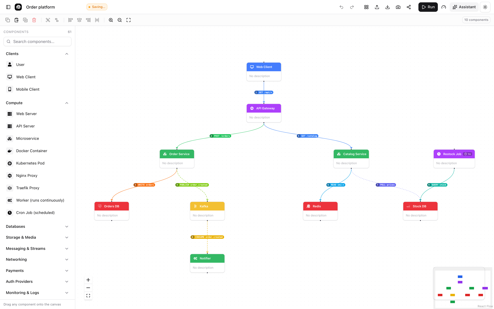
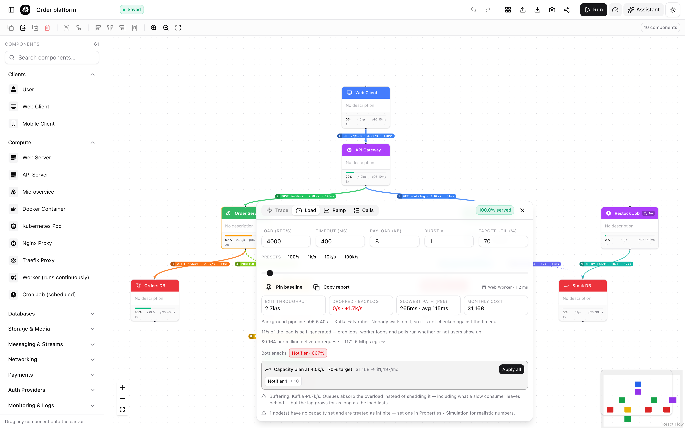
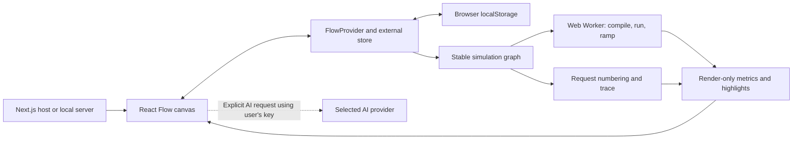

<div align="center">

# Nautilus

**Design software architecture, explain request flows, and explore capacity bottlenecks in your browser.**

[](https://github.com/Somilg11/nautilus/actions/workflows/ci.yml)
[](LICENSE)

[Live app](https://nautilusss.vercel.app) · [Documentation](https://nautilusss.vercel.app/docs) · [Interview preparation](about.md)



</div>

## What the project does

Nautilus is a local-first system-design editor. A diagram is a directed graph: nodes represent components, and edges describe interactions. You can replay those interactions, configure component capacity, and explore how a hypothetical architecture behaves under load.

The editor, graph algorithms, and load model run in the browser. There is no application API, database, authentication service, or server-side diagram storage. The default deployment still uses Next.js to build and serve the application; the CLI and Electron shell start a local Next.js production server. Optional AI requests go directly to the selected provider.

The load playground is an **analytical model**, not a real load test. It does not send traffic to the services drawn on the canvas. Company-inspired templates are educational examples, not verified representations of those companies' production systems.

## Features

| Area | Implemented behavior |
| --- | --- |
| Architecture canvas | React Flow editor with pan, zoom, selection, minimap, drag-and-drop, node properties, and editable connections |
| Component palette | 61 items across 10 categories: clients, compute, databases, storage/media, messaging, networking, payments, auth providers, monitoring/logs, and cloud providers |
| Editing tools | Copy/paste, duplicate, delete, group/ungroup, align, distribute, keyboard nudging, undo, and redo |
| Request model | 13 operations: `GET`, `POST`, `PUT`, `PATCH`, `DELETE`, `CALL`, `READ`, `WRITE`, `QUERY`, `PUBLISH`, `EVENT`, `CONSUME`, `POLL` |
| Connection properties | Operation, endpoint/topic, call order, timeout, polling interval, traffic share, and fan-out; inferred operations for unannotated edges |
| Trace playback | Numbered request replay with play, pause, stop, step back/forward, jump-to-step, and 0.5×, 1×, 2×, or 4× speed |
| Background work | Interval-based cron jobs, per-replica worker loops, and polling edges, with generated load reported separately |
| Load playground | Capacity, replicas, service latency, baseline error rate, cache hits, failure injection, utilization, modeled p95, drops, backlog, consumer lag, and bandwidth estimates |
| Capacity planning | Replica recommendations for a target utilization, optional hourly cost inputs, monthly cost estimates, and application of scale recommendations |
| Comparison | Pin a simulation baseline and inspect changes against it |
| Load ramp | Sample offered load versus exit throughput; report the first sampled overload/backlog point and timeout breach |
| Templates | Three-tier, microservices, Uber, Instagram, Spotify, Netflix, WhatsApp, YouTube, and Zomato |
| AI assistant | Bring-your-own-key OpenAI, Gemini, Claude, and Groq clients; conversation, review, and proposed diagrams with replace/add/discard controls |
| Persistence and sharing | Browser autosave, JSON import/export, PNG export, compressed diagram URLs, and Markdown capacity reports |
| Presentation | Light/dark themes, landing page, documentation routes, metadata, sitemap, robots configuration, and web app manifest |
| Distribution | Next.js web app, local CLI launcher, and optional Electron shell with installer build configuration |

Icons such as PostgreSQL, Kafka, Redis, Stripe, AWS, and Kubernetes are **diagram components**. This repository does not operate those systems or integrate with their service APIs.

## Technology stack

Versions below come from the committed manifests and lockfile, not claims about the latest upstream releases.

| Technology | Version in repository | Purpose |
| --- | --- | --- |
| Next.js | `^16.3.1` declared; `16.4.0` locked | App Router, page routing, metadata, build, and HTTP serving |
| React / React DOM | `19.2.0` | Interactive editor and UI |
| TypeScript | `^5` declared; `5.9.3` locked | Strict type checking for UI, document shapes, and simulation contracts |
| React Flow (`reactflow`) | `11.11.4` locked | Node/edge canvas, handles, viewport, selection, and minimap |
| Tailwind CSS | `4.1.17` locked | Styling, with local shadcn-style components and Radix primitives |
| Web Workers | Browser API | Load computation outside the UI thread, with an inline fallback |
| `lz-string` | `^1.5.0` declared | Diagram compression for share URLs |
| `html-to-image` | `^1.11.13` declared | PNG capture of the canvas element |
| `next-themes` | `^0.4.6` declared | Theme preference and switching |
| Lucide / React Icons | See `package.json` | Interface icons and architecture palette icons |
| Sonner / UUID | See `package.json` | Notifications and generated node identifiers |
| `react-hotkeys-hook` | `^5.2.1` declared | Installed dependency; current canvas shortcuts use native `keydown` listeners instead |
| CVA / `clsx` / `tailwind-merge` | See `package.json` | Component variants and class composition |
| Vitest | `4.1.11` locked | Pure-core tests in Node |
| ESLint | `^9` declared | Source linting with Next.js rules |
| Electron / electron-builder | `43.7.9` / `26.17.0` locked | Optional desktop shell and installer packaging |
| GitHub Actions | `.github/workflows/ci.yml` | Lint, type checking, tests, build, and dependency audits |

React state and a small context/external-store layer manage the document; the project does not use a directly configured Redux or Zustand store. No ORM, database schema, or application REST API is present.

## Run locally

Use **Node.js 22.12.0 or newer within the 22.x release line** for a consistent web and desktop development setup. The locked Next.js package requires Node `>=20.9.0`; the locked Electron package requires `>=22.12.0`. CI currently configures Node 20 and does not test desktop packaging.

```bash
git clone https://github.com/Somilg11/nautilus.git
cd nautilus
npm ci
npm run dev
```

Open `http://localhost:3000/dashboard`. No environment file or AI key is required for editing, templates, traces, or load modeling. Dependency installation and the build may need internet access; the layout uses `next/font/google` for Geist fonts.

For a production build:

```bash
npm run build
npm start
```

For the local browser launcher:

```bash
npm run start:app -- --no-open
npm run start:app -- --port 4000 --host 127.0.0.1 --no-open
```

The launcher builds if `.next/BUILD_ID` is absent, selects an available port starting at the requested port, and opens the default browser unless `--no-open` is provided. Rebuild after source changes; an existing production build is reused.

For the Electron shell and installer targets:

```bash
npm run desktop
npm run desktop:build
```

The shell opens `/dashboard` using the same local production server. Configured targets are macOS DMG, Windows NSIS, and Linux AppImage. Packaging configuration is present; this documentation does not assert that signed installers have been released or tested on every platform. Desktop builds need normal Electron installation scripts enabled.

### Optional configuration

| Setting | Used by | Effect |
| --- | --- | --- |
| `NEXT_PUBLIC_SITE_URL` | `src/lib/site.ts` | Build-time canonical, sitemap, robots, and social metadata origin; defaults to `https://nautilusss.vercel.app` |
| `PORT` | CLI launcher | Starting port; defaults to `3000`, and `--port` overrides it |
| `NAUTILUS_PORT` | Electron shell | Starting local server port; defaults to `3777` |
| `NAUTILUS_DEVTOOLS=1` | Electron shell | Opens renderer developer tools |

Enter optional AI keys and model overrides in the right sidebar's Settings tab. They are browser settings, not server environment variables. Provider access, model availability, browser request policy, quotas, and billing are external requirements; configured defaults are not a guarantee that an account can use a model.

### Deployment scope

The checked-in configuration supports a standard Next.js build and server, including deployment through a compatible hosting platform. It does **not** enable `output: "export"`. Static-only hosting requires configuration changes and host-managed security headers. There is no committed Dockerfile or Docker Compose setup. See [self-hosting notes](docs/SELF_HOSTING.md) for examples, and check them against the current configuration before deployment.

## Five-minute demo

1. Open `/dashboard` and load the microservices template.
2. Explain a numbered connection: source, target, operation, endpoint/topic, and whether the caller waits.
3. Run the trace. Pause, step forward, and inspect the Calls tab.
4. Open the load playground. Increase offered requests per second and identify the first constrained component.
5. Explain why a service drops excess traffic while a queue accumulates backlog or a consumer leaves lag.
6. Pin a baseline, change a replica count or cache hit ratio, and compare the results.
7. Inspect the Ramp tab and capacity recommendation. Explain the assumptions before interpreting the numbers.
8. Export JSON, copy a report, or generate a share URL. Use a synthetic diagram for a public demo.



Screenshots illustrate the UI; their values are scenario-specific model outputs.

## Architecture and data flow



1. **Document:** `{ name, nodes, edges, sim }` is the persistent diagram. `node.data.sim` stores component settings; `edge.data.flow` stores interaction semantics; `edge.data.sim` stores routing settings.
2. **Store:** `FlowProvider` owns React state, immutable history snapshots, clipboard operations, import, and autosave. `useSyncExternalStore` exposes subscriptions with a stable store context.
3. **Projection:** `createGraphProjector` ignores positions and selection. It reuses its result until relevant node data or edge structure changes. Cosmetic data edits may still invalidate it because node data is compared by reference.
4. **Trace:** `computeSequence` infers or reads operations, sorts outgoing calls, follows synchronous/pull paths, and defers async/poll continuations. `useSimulation` replays this sequence; it executes no actual requests.
5. **Load engine:** `compileGraph` builds indexed adjacency data. `runCompiled` evaluates demand, throughput, latency, and sizing; `sweepCompiled` reuses the compiled graph for ramp samples.
6. **Scheduling:** one load run is in flight at a time; a newer waiting request replaces the previous queued request. The transport has a main-thread fallback if worker creation or loading fails.
7. **Rendering:** cached decorators add metrics and trace marks to rendered objects. These computed fields are kept out of document state, history, and persistence.

### How to interpret the model

| Quantity | Implemented interpretation |
| --- | --- |
| User load | Requests per second × burst factor, divided evenly across eligible entry points |
| Component capacity | Per-replica capacity × replica count; absent or nonpositive capacity is treated as unbounded by the engine |
| Downstream calls | Successful forwarded traffic × edge share × fan-out; cache hits reduce forwarding |
| Scheduled work | Fixed-interval cron rate, per-replica worker rate, and per-replica poll rate; not a cron-expression parser |
| Queue wait | M/M/1-style approximation based on configured latency and utilization, with numerical caps near saturation |
| p95 | Single-hop exponential estimate and multi-hop mean/variance approximation; not measured latency |
| Replica advice | Healthy upstream demand divided by per-replica capacity and target utilization, rounded up; worker self-load excluded from sizing demand |
| Monthly cost | Configured hourly cost × replicas × 730; no cloud price lookup |
| Delivered throughput | Sum of forwarded traffic at exit nodes; fan-out can make this exceed input RPS |
| Displayed success rate | `1 - totalDropped / totalRequests` across internal calls; not end-user transaction success and not inclusive of baseline errors or timeout failures |
| Ramp | Default 24 positive load samples up to `max(1000, 2 × current RPS)` in the UI; knee and timeout are sampled estimates |

See [about.md](about.md) for formulas, worked examples, trade-offs, and interview answers.

## Diagram format

This complete example can be saved as JSON and imported. The API service has two replicas; every request queries the database.

```json
{
  "name": "Orders example",
  "nodes": [
    {
      "id": "api",
      "type": "nautilusNode",
      "position": { "x": 120, "y": 40 },
      "data": {
        "label": "Orders API",
        "icon": "api_server",
        "color": "green",
        "sim": { "capacity": 500, "replicas": 2, "latencyMs": 20, "costPerHour": 0.1 }
      }
    },
    {
      "id": "db",
      "type": "nautilusNode",
      "position": { "x": 120, "y": 280 },
      "data": {
        "label": "Orders database",
        "icon": "postgres",
        "color": "red",
        "sim": { "capacity": 2000, "replicas": 1, "latencyMs": 10, "costPerHour": 0.2 }
      }
    }
  ],
  "edges": [
    {
      "id": "api-db",
      "source": "api",
      "target": "db",
      "data": {
        "flow": { "op": "QUERY", "path": "orders", "timeoutMs": 500 },
        "sim": { "share": 1, "fanout": 1 }
      }
    }
  ],
  "sim": {
    "requestsPerSecond": 500,
    "timeoutMs": 500,
    "payloadKb": 8,
    "targetUtilization": 0.7,
    "burstFactor": 1
  }
}
```

Imports, saved diagrams, share links, and AI proposals pass through `sanitizeDiagram`. It limits input to 2,000 nodes and 4,000 edges, bounds recognized simulation fields, caps strings, removes duplicate node IDs, repairs duplicate edge IDs, and drops connections with missing endpoints. It is input normalization, not a formal proof of safety; some nested metadata receives less validation.

## Persistence, sharing, and security

- Autosave writes the current diagram and load settings to `localStorage` after a 600 ms debounce. The project name has a separate key. History stores at most 50 node/edge snapshots in memory and resets on reload; project names and load parameters are not included in undo snapshots.
- There is one current autosaved canvas per browser origin, not an account-based project database. Export JSON for backup or transfer.
- Share links compress the diagram into `/dashboard?d=...` using `lz-string`. Compression is not encryption. Anyone with the URL can read the diagram, and URLs may appear in browser history and host logs. Links above 8,000 characters trigger a warning; use JSON for large diagrams.
- AI keys, model preferences, and chat history are also stored in browser local storage. AI calls send the prompt, recent conversation, and a bounded canvas description to the selected provider. The app has no bundled analytics integration; ordinary asset, navigation, hosting, and optional AI network traffic still exists.
- `next.config.ts` configures CSP and other HTTP security headers. `connect-src` permits the same origin and four provider hosts; `worker-src` permits the same origin and `blob:`. Inline styles remain allowed.
- After a production build, `scripts/csp-hashes.mjs` attempts to replace inline-script permission with hashes in `.next/routes-manifest.json`. If expected output is unavailable, it logs a warning and retains `'unsafe-inline'`. Verify actual deployment headers; strict hash enforcement is not universal.
- Electron enables `contextIsolation` and `sandbox`, disables renderer Node integration, and opens external navigation through the system browser.

API keys in local storage are readable by JavaScript running on the origin. Validation and CSP reduce exposure but do not make browser storage a secret vault. Use provider keys with appropriate scope and spending controls. See [SECURITY.md](SECURITY.md) for the repository's reporting process and threat model.

## Project structure

```text
src/app/                         Landing, dashboard, docs, about, metadata routes
src/components/canvas.tsx        Canvas wiring, editing, load controls, rendering
src/components/toolbar.tsx       Import/export, sharing, commands
src/components/left-sidebar.tsx  Component palette
src/components/right-sidebar.tsx Node properties, AI chat, provider settings
src/components/edge-inspector.tsx Connection editing
src/components/simulation-panel.tsx Trace, Load, Ramp, Calls, comparison/report UI
src/components/nodes/            Custom architecture and group nodes
src/components/edges/            Edge badges, rendering, shared markers
src/components/ui/               Local UI primitives
src/lib/flow-context.tsx          Document state, history, persistence, imports
src/lib/flow-ops.ts               Operations, inference, schedules, numbering
src/lib/flow-execution.ts         Layered dependency planner
src/lib/simulation-model.ts       Analytical model, ramp, cost/report helpers
src/lib/sim-engine.ts             Worker-compatible message engine
src/lib/sim-worker.ts             Web Worker entry point
src/lib/use-load-engine.ts        Transport, scheduling, inline fallback
src/lib/sim-graph.ts              Identity-preserving graph projection
src/lib/canvas-decorate.ts        Cached render-time decorations
src/lib/use-simulation.ts         Trace playback state machine
src/lib/diagram-io.ts             Untrusted document normalization
src/lib/ai-client.ts              Direct browser calls to four AI providers
src/lib/ai-schema.ts              Diagram instructions for AI output
src/lib/auto-layout.ts            Dependency-layer layout for AI proposals
src/lib/templates/               Nine educational architectures
src/lib/__tests__/               Six Vitest test files
bin/                            CLI and shared local-server utilities
desktop/                        Electron main process
scripts/                        CSP post-build hardening and icon generation
docs/                           Feature, architecture, deployment guides/images
.github/workflows/ci.yml         Automated quality checks
```

## Commands and verification

| Command | Purpose |
| --- | --- |
| `npm run dev` | Next.js development server |
| `npm run build` | Next.js production build, then CSP hash patch attempt |
| `npm start` | Serve an existing production build |
| `npm run lint` | ESLint |
| `npm run typecheck` | TypeScript without emitting application code |
| `npm test` | Vitest test suite in Node |
| `npm run test:watch` | Vitest watch mode |
| `npm run start:app` | Local CLI launcher |
| `npm run desktop` | Electron shell |
| `npm run desktop:build` | Web production build followed by electron-builder |

Run checks separately so each failure is visible:

```bash
npm run lint
npm run typecheck
npm test
npm run build
```

The suite defines **113 test cases in six files**, including 45 parameterized template checks. Coverage includes request inference/numbering, graph planning, load arithmetic, queue/cache/schedule semantics, cost/ramp/report behavior, validation, engine serialization, and graph projection. There are no committed React component tests or browser end-to-end tests. Test count describes the checked-in suite; use `npm test` for the result in your environment.

CI runs for pushes to `main` and pull requests: dependency install, lint, typecheck, tests, build, production dependency audit at high severity, and full dependency audit at critical severity. Audit steps are configured gates, not a claim that the current dependency tree has no advisories.

## Limits and next steps

- The model assumes steady state and an approximate pooled M/M/1 queue. It does not implement real request execution, retries, circuit breakers, queue retention limits, autoscaling delay, or a discrete-event simulation.
- Capacity and service time are independent user inputs. Estimates require consistent assumptions and comparison with real measurements before operational use.
- Cyclic graphs are flagged. Kahn's unresolved remainder includes nodes downstream of cycles; the engine still produces a bounded single-pass result, which is not a solved feedback model. Self-loops carry no traffic.
- Edge call order controls trace numbering. Load latency follows the slowest dependency path; it does not sum all explicitly ordered sibling calls.
- Ramp capacity thresholds are sampled estimates; latency budget breaches are reported separately from the ramp's drop/backlog cleanliness test.
- The editor is desktop-first. Viewport culling, memoized renderers, cached decorators, and reduced decoration help large diagrams, but no node-count or frame-rate guarantee is established here.
- PNG captures the canvas DOM element; JSON is the editable document format. SVG/PDF export and live multi-user collaboration are not implemented.
- A manifest is present, but no service worker or guaranteed offline installation is implemented.

Potential improvements include better sequential-call latency semantics, error-aware transaction success reporting, transport stale-result rejection, browser regression tests, richer queue/retry models, weighted entry traffic, and explicit static-export/desktop release verification. These are future work, not shipped features.

## Further reading

| Document | Purpose |
| --- | --- |
| [about.md](about.md) | Interview pitch, technology choices, algorithms, formulas, worked examples, questions, demo, and study plan |
| [docs/FEATURES.md](docs/FEATURES.md) | Detailed feature reference |
| [docs/ARCHITECTURE.md](docs/ARCHITECTURE.md) | Additional implementation notes |
| [docs/SELF_HOSTING.md](docs/SELF_HOSTING.md) | Deployment examples and operator notes |
| [CONTRIBUTING.md](CONTRIBUTING.md) | Contribution workflow and extension guides |
| [SECURITY.md](SECURITY.md) | Security reporting and threat model |
| [CODE_OF_CONDUCT.md](CODE_OF_CONDUCT.md) | Community conduct |

## License

[MIT](LICENSE). Copyright Somil Gupta and Nautilus contributors.
