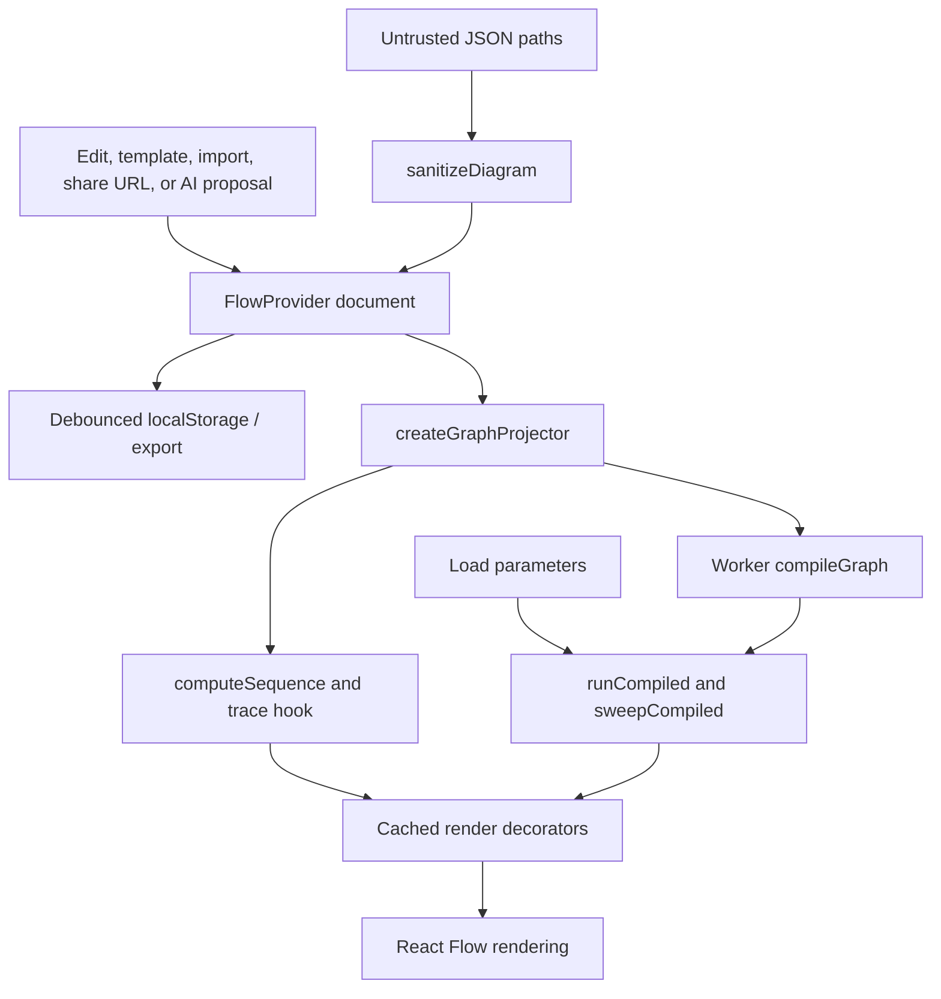

# Nautilus: interview preparation guide

This guide explains the implementation in this repository: what the application does, why its technologies fit, how its algorithms work, and where its assumptions stop being useful. Read [README.md](README.md) for setup and feature inventory.

The first-person answers below are rehearsal drafts. Use them only for work you personally implemented or can explain. Source code establishes current behavior; it does not establish your ownership, user adoption, production reliability, or historical performance gains. No benchmark result or customer metric is claimed here without reproducible evidence.

## Contents

1. [Project pitch](#1-project-pitch)
2. [Problem, scope, and demo](#2-problem-scope-and-demo)
3. [Technology choices and alternatives](#3-technology-choices-and-alternatives)
4. [Architecture and document lifecycle](#4-architecture-and-document-lifecycle)
5. [Graph algorithms and request semantics](#5-graph-algorithms-and-request-semantics)
6. [Load model and worked calculations](#6-load-model-and-worked-calculations)
7. [React state, performance, and concurrency](#7-react-state-performance-and-concurrency)
8. [AI integration and validation](#8-ai-integration-and-validation)
9. [Privacy and security trade-offs](#9-privacy-and-security-trade-offs)
10. [Deployment, tooling, and testing](#10-deployment-tooling-and-testing)
11. [Interview questions and answer outlines](#11-interview-questions-and-answer-outlines)
12. [Engineering stories to prepare](#12-engineering-stories-to-prepare)
13. [Resume bullets and claims to avoid](#13-resume-bullets-and-claims-to-avoid)
14. [Study plan and final checklist](#14-study-plan-and-final-checklist)
15. [Code reading map and reference numbers](#15-code-reading-map-and-reference-numbers)

## 1. Project pitch

### One sentence

Nautilus is a local-first architecture editor that turns diagrams into numbered request flows and browser-based capacity models.

### Thirty seconds

“Nautilus helps explain how requests move through a system and where a proposed architecture runs out of capacity. Users draw components, annotate interactions, replay the request flow, and configure capacity, replicas, latency, caching, and background work. A browser-based analytical model estimates bottlenecks, queue growth, and replica costs. I used Next.js, React, TypeScript, and React Flow, with a Web Worker for load computation. Diagrams are saved locally or exported as JSON, and optional AI uses the user's own provider key.”

### Two minutes

Add three technical points:

1. **Semantics:** an arrow can mean a synchronous call, asynchronous event, consumer pull, or timed poll. Those differences affect trace order, generated traffic, and latency boundaries.
2. **Modeling:** a saturated service drops work, a queue buffers it, and a slow consumer leaves lag in its upstream queue. Capacity recommendations use healthy upstream demand so an earlier bottleneck does not hide downstream requirements.
3. **Responsiveness:** the editor projects only relevant document data into a stable simulation graph, compiles it in a worker, and reuses that compilation across load changes. Rendering adds computed metrics without persisting them in the document.

Finish with the limit: “These are educational steady-state estimates. The tool does not execute a real distributed system or measure production latency.”

## 2. Problem, scope, and demo

### The problem

A static diagram rarely communicates whether a caller waits, how frequently background jobs run, or how much traffic an edge carries. Real load testing requires an implemented system. Nautilus offers a lightweight way to explore those assumptions before implementation.

The intended use cases are interview preparation, learning system design, and explaining design trade-offs. The repository does not establish adoption numbers or production capacity accuracy.

### What is implemented

- A React Flow canvas with 61 palette items in 10 categories, grouping, alignment, copy/paste, and session undo/redo.
- Thirteen interaction operations, four modes, inferred defaults, and numbered trace playback.
- Node and edge load parameters, scheduled work, cache forwarding, queue backlog, consumer lag, modeled latency, failure injection, capacity recommendations, and cost estimates.
- Nine educational templates, browser autosave, JSON/PNG export, compressed share URLs, and Markdown reports.
- Optional direct-to-provider AI, plus a local CLI launcher and Electron shell.

**Scope boundary:** Redis, Kafka, PostgreSQL, Kubernetes, payment providers, and cloud services appear as diagram symbols. Nautilus does not run them. Next.js serves the application, but there is no custom application backend, account service, database, or server-side diagram persistence.

### Five-minute interview demo

| Time | Action | Explain |
| --- | --- | --- |
| 0:00–0:40 | Load the microservices template | The document is a graph with typed interactions and model inputs |
| 0:40–1:20 | Inspect one connection and play/pause the trace | Operation, caller/receiver, call order, async boundary, and numbered replay |
| 1:20–2:10 | Open Load and increase RPS | Offered versus accepted work, utilization, and the constrained component |
| 2:10–3:00 | Inspect a queue and consumer | Backlog is retained work; lag is not automatically dropped traffic |
| 3:00–3:40 | Pin a baseline and adjust replicas | Demand-based sizing and cost of additional headroom |
| 3:40–4:20 | Inspect Ramp | Sampled overload threshold and separate timeout threshold |
| 4:20–5:00 | Export JSON or copy a report | Local persistence, portable documents, and model limitations |

Prepare a JSON backup before the interview. Use AI only as an optional demonstration: access and model behavior depend on external services. Company-inspired examples are illustrative, not audited production architectures.

## 3. Technology choices and alternatives

The “why” column explains a defensible engineering rationale. It is not a claim that every choice followed a recorded comparison experiment.

| Choice | Where used | Why it fits | Alternative and trade-off |
| --- | --- | --- | --- |
| Next.js 16 App Router | `src/app/`, `next.config.ts` | File-based routes, shared layouts, metadata, docs, and a standard production build | Vite/React would reduce framework overhead for a canvas-only SPA; Next.js supplies a broader website shell |
| React 19 | Components and hooks | Declarative UI and reusable components for panels, forms, and graph renderers | Imperative canvas UI can reduce DOM cost but requires more custom interaction/accessibility work |
| TypeScript strict mode | `tsconfig.json`, model contracts | Checks graph shapes, operation unions, worker messages, and report structures before runtime | JavaScript needs more runtime discipline; TypeScript still does not validate imported JSON or enforce physical units |
| React Flow v11 | `canvas.tsx`, custom nodes/edges | Provides graph interaction, handles, selection, viewport, minimap, and controlled updates | Building graph interaction from scratch is substantial work; DOM/SVG rendering still has a large-diagram ceiling |
| React state + context/external store | `flow-context.tsx` | Keeps a small application-owned document API without another state dependency | Redux/Zustand could provide established patterns and devtools; custom store code requires careful subscriptions and immutable updates |
| Web Worker | `sim-worker.ts`, `use-load-engine.ts` | Moves calculation away from pointer/input processing | Worker startup and structured-clone overhead; inline fallback preserves function but loses thread isolation |
| Pure TypeScript model | `simulation-model.ts` | Reusable in workers and Node tests, deterministic for fixed inputs | A backend is unnecessary for current calculations; a discrete-event engine would model more behavior at greater cost |
| Tailwind CSS 4 | Styles and component classes | Consistent styling close to component markup | CSS Modules could reduce utility density but require more separate stylesheet coordination |
| Local shadcn-style UI + Radix | `components/ui/` | Editable component source on top of interaction primitives | A fully managed UI library reduces local maintenance but limits control; accessibility still needs application testing |
| CVA, `clsx`, `tailwind-merge` | UI class helpers | Variants, conditional classes, and conflicting Tailwind class resolution | Manual concatenation is simpler initially but harder to standardize |
| `next-themes` | Theme provider/toggle | System theme and persisted light/dark preference | A custom theme implementation adds hydration and persistence handling |
| Lucide and React Icons | Toolbar and palette | Interface symbols and recognizable technology logos | Custom SVG assets give tighter control but need separate maintenance |
| Sonner | Notifications | User feedback for import, export, errors, and clipboard actions | Inline messages can be better for persistent form errors; toasts alone are insufficient for all feedback |
| Native keyboard listeners | `canvas.tsx` | Explicit shortcut dispatch, focus guards, and cleanup | `react-hotkeys-hook` is declared but not imported by current source; it is not the implemented shortcut mechanism |
| UUID and `crypto.randomUUID` | Node creation and graph duplication | Avoid collisions across imported and copied documents | UUID is used by the node factory; browser-generated UUIDs are also used directly in editing and AI append paths |
| `lz-string` | Share URL encoding | Self-contained compressed sharing with no storage service | Saved-link backend gives short URLs and revocation but adds state and operating cost |
| `html-to-image` | Toolbar PNG export | Captures the rendered canvas DOM/SVG with little custom exporter code | A vector exporter offers editable output but must implement graph serialization/rendering separately |
| Vitest | `src/lib/__tests__/` | Tests TypeScript algorithms in Node without a browser | Component and browser behavior require a different test layer |
| ESLint + TypeScript + Actions | Configs and workflow | Complementary style/static checks and repeatable CI | They cannot establish visual correctness, model realism, or absence of security vulnerabilities |
| Electron + electron-builder | `desktop/`, package build config | Reuses the web interface inside a native window | Larger installers and more runtime dependencies than a browser app; cross-platform packaging needs separate validation |
| Local storage + JSON files | Document and AI settings | Low setup cost, per-origin persistence, exportable data | Synchronous storage, quota limits, no cloud backup, no collaboration, and plaintext keys |

Current locked versions are Next.js `16.4.0`, React `19.2.0`, React Flow `11.11.4`, TypeScript `5.9.3`, Tailwind `4.1.17`, Vitest `4.1.11`, Electron `43.7.9`, and electron-builder `26.17.0`. Use the committed lockfile when discussing the repository; these are not upstream availability recommendations.

### Why no application backend?

The current product can manipulate documents and compute estimates locally. Removing server-side account and document services reduces setup and operating work and keeps ordinary diagrams off an application database. The cost is no multi-device sync, account recovery, centralized key protection, or shared editing. Hosting, downloads, builds, and optional paid AI still have costs.

## 4. Architecture and document lifecycle

### Three layers

1. **Document/UI layer:** `FlowProvider`, React Flow, palette, inspectors, toolbar, and simulation panel.
2. **Pure domain layer:** operation resolution, graph planning, load arithmetic, validation, layout, and reporting.
3. **Adapters:** Web Worker transport, local storage, file/clipboard APIs, AI HTTP clients, local server launcher, and Electron main process.



### Persistent schema

```text
Diagram
  name                 Human-readable project name
  nodes[]              IDs, type, position, labels, icons, grouping, model inputs
    data.sim           Capacity, replicas, latency, error rate, cache, cost, schedule
  edges[]              IDs, source/target IDs, handles, optional label
    data.flow          Operation, path, order, poll interval, timeout
    data.sim           Traffic share, fan-out, legacy async flag
  sim                  RPS, request budget, payload, utilization target, burst factor
```

`NodeSimConfig`, `EdgeFlowConfig`, `EdgeSimConfig`, `LoadParams`, and `SimulationReport` describe related structures. Persisted graph data is distinct from `__metrics`, `__simStatus`, and other render-only fields.

### A user edit

A component changes node/edge arrays through the document actions. Relevant changes produce a new projected graph. Numbering is recomputed, and the load worker receives a graph update if enabled. Slider changes send run parameters while retaining the compiled graph. Returned metrics are merged into rendered objects rather than written into stored nodes.

The projector checks node `data` identity, not individual fields. A change to a description or color can therefore invalidate the simulation graph even if it does not affect arithmetic. Position and selection changes with unchanged data do not.

### Persistence and history

- Autosave waits 600 ms after document/load changes, then serializes to `nautilus-canvas-v1`.
- The name is stored separately as `nautilus-project-name`.
- History stores at most 50 immutable node/edge snapshots in refs. The initial state occupies a snapshot; do not promise 50 independent undo operations.
- Identity comparisons skip identical snapshots. Unchanged node/edge objects can be shared across snapshots; the whole document is not deep-cloned for each edit.
- Dragging uses a commit boundary rather than recording every pointer move. Selection is not intended as a document edit.
- Load parameters and project name are outside the node/edge history snapshots. Undo does not roll back every application setting.
- History is in memory and is lost on reload. Local autosave is one current canvas per origin, not a project database or backup.

### Sharing

`JSON.stringify` produces the document, `lz-string` compresses it for a URL, and the toolbar copies `/dashboard?d=...`. The receiving provider decompresses, parses, and normalizes it. No share-record service is involved.

The URL has no access control, revocation, or expiry. It can become very long, and parsing/decompression happens before graph-size limits apply. The current link generator assumes root-path hosting; adding a Next.js base path alone does not fix every hardcoded dashboard URL.

## 5. Graph algorithms and request semantics

### Operation resolution

`resolveFlow` prefers an explicitly allowed operation. Otherwise it uses the legacy async flag or component roles: a queue source suggests `CONSUME`, a queue target suggests `PUBLISH`, a database target suggests `QUERY`, a cache target suggests `READ`, and the fallback is `CALL`.

Inference preserves older diagrams but can choose the wrong business meaning. Users can override it. An operation's path is a label; it is never fetched or executed.

| Mode | Operations | Meaning in this project |
| --- | --- | --- |
| `sync` | HTTP verbs, `CALL`, `READ`, `WRITE`, `QUERY` | Caller waits on target work |
| `async` | `PUBLISH`, `EVENT` | Handoff creates a separate downstream latency chain |
| `pull` | `CONSUME` | Queue-to-consumer data-flow direction; unprocessed work remains upstream |
| `poll` | `POLL` | Source generates timer-driven calls independently of incoming user traffic |

A consumer initiates the pull in real life, but a consume edge is drawn **queue → consumer** to represent work movement. Explain that convention explicitly.

### Layered execution planning

`computeExecutionPlan` uses Kahn's algorithm:

1. Ignore group nodes and record invalid endpoints/self-loops as non-carried edges.
2. Build incoming counts and adjacency lists.
3. Collect nodes with zero incoming edges.
4. Emit a layer, decrement their neighbors' counts, and collect the next layer.
5. Report unprocessed nodes and append them as a cyclic remainder.

The remainder includes nodes **in or downstream of** a cycle; it is not an exact strongly connected component analysis. `isolatedNodes` means nodes with no incoming or outgoing connections. Self-loops are recorded as invalid/non-carried edges rather than solved feedback.

### Request numbering

`computeSequence` is a different traversal from the layered planner. It sorts a source's outgoing edges by explicit `order`, then insertion order. An iterative depth-first stack follows synchronous and pull work. Async/poll edges are numbered when encountered, while expansion beyond them is deferred. Self-starting roots and remaining cyclic regions are considered after normal entries.

This produces a presentation sequence with each eligible edge considered once. It does not instantiate one trace per request or duplicate a shared component's subtree for every caller. A stack avoids recursion depth failures on long chains.

### Entry points and background work

User traffic is divided among eligible zero-incoming nodes. Scheduled nodes and nodes with only polling outputs are excluded. An isolated unscheduled component can still be considered an entry; it is also reported as isolated.

- Cron rate: `batch × 1000 / everyMs`.
- Worker-loop rate: `replicas × batch × 1000 / everyMs`.
- Poll edge rate: `sourceReplicas × fanout × 1000 / intervalMs`.

These are fixed-interval rates. Cron expressions, wall-clock calendars, overlap policies, and real timers for every simulated request are not implemented. A failed poller stops emitting modeled polls.

### Complexity, stated accurately

Let `V` be executable nodes and `E` eligible edges.

| Operation | Complexity and qualification |
| --- | --- |
| `computeExecutionPlan` | `O(V + E)` time and graph storage |
| `computeSequence` | Traversal plus outgoing-edge sorting: `O(V + E log E)` worst case |
| `compileGraph` | `O(V + E)`; prepares indexed arrays and resolved semantics |
| `runCompiled` | Core demand/forward/backward passes are `O(V + E)`; report ranking adds up to `O(V log V)`, and path reconstruction is bounded by `V` |
| `sweepCompiled` | `S` calls to `runCompiled`; defaults to `S = 24` |
| `sanitizeDiagram` | Approximately `O(V + E)` over retained inputs, with bounded field work; raw JSON parsing/decompression is separate |
| Graph projection | `O(V + E)` comparisons when arrays change; retains result identity for cosmetic changes |
| Render decorators | `O(V + E)` mapping; cached objects reduce allocations and downstream rendering |
| `autoLayout` | `O(V + E)` dependency planning and layered coordinate assignment |

Do not describe the full model/report pipeline as strictly linear while ignoring its sorting steps.

## 6. Load model and worked calculations

### What kind of simulation is this?

It is a deterministic **steady-state analytical model**. It computes rates and approximate queueing latency over a dependency order. It does not create individual messages, schedule discrete events, connect real services, or measure actual response times.

The phases are:

1. Compile IDs, indices, adjacency, operation modes, capacity settings, and entry classification.
2. Propagate healthy demand without capacity shedding or failure injection, retaining configured baseline error/cache behavior.
3. Propagate actual offered/served/forwarded work and classify overflow.
4. Walk dependencies backward for per-call response estimates.
5. Aggregate bottlenecks, paths, costs, scaling advice, and ramp/report data.

### Traffic and capacity formulas

```text
peakLoad = requestsPerSecond × burstFactor
entryLoad = peakLoad / eligibleEntryCount

nodeOffered = entryShare + scheduledWork + incomingEdgeRates
nodeCapacity = perReplicaCapacity × replicas
servable = min(nodeOffered, nodeCapacity)
served = servable × (1 - errorRate)
forwarded = served × (1 - hitRate)

ordinaryEdgeRate = sourceForwarded × share × fanout
utilization = nodeOffered / nodeCapacity
```

A down node has zero capacity and no self-generated work. Missing or nonpositive capacity becomes unbounded in `compileGraph`, despite the UI's suggested capacity default of 500. This can make a hand-built diagram optimistic; the report identifies unbounded nodes.

**Share is not a router normalization rule.** Every edge defaults to share 1 and fan-out 1. Two outgoing edges can each receive all source traffic. To model an even split, set both shares to 0.5. Nothing automatically forces outgoing shares to sum to one.

### Queue wait and p95

For configured service time `s` and utilization `u`, the implemented wait approximation is:

```text
uEffective = min(u, 0.99)
queueMs = min(s × uEffective / (1 - uEffective), 50 × s)
meanHopMs = s + queueMs
singleHopP95Ms = ln(20) × meanHopMs
```

The calculation applies when capacity is finite and positive. Down nodes have zero modeled latency. Caps keep saturated results finite and readable; an overloaded steady-state queue is not mathematically stable merely because the UI shows a number.

For a selected path, the implementation sums means and squared hop means as approximate variances:

```text
pathMean = Σ hopMean
pathVariance ≈ Σ hopMean²
pathP95 ≈ pathMean + 1.645 × sqrt(pathVariance)
```

This is a normal approximation under independence assumptions, not an exact tail calculation. Single-hop node p95 uses `ln(20)`, while path/per-call p95 uses the mean/variance expression, even for a one-hop path. Those displayed values need not match.

Capacity and configured latency are independent inputs, so the model is M/M/1-style rather than a fully calibrated queueing system. Replica capacity is pooled; it does not solve M/M/c.

### Worked example: capacity, latency, and cost

Assume one API node receives 600 requests/s. Each replica has capacity 500 requests/s, configured service time is 20 ms, there are two replicas, hourly cost is 0.10, and the utilization target is 0.7.

```text
Total capacity = 500 × 2 = 1000 requests/s
Utilization = 600 / 1000 = 0.6
Queue wait = 20 × 0.6 / 0.4 = 30 ms
Modeled mean = 20 + 30 = 50 ms
Single-hop p95 = ln(20) × 50 ≈ 149.79 ms
Required replicas = ceil(600 / (500 × 0.7)) = 2
Monthly cost = 0.10 × 2 × 730 = 146
```

At 1,200 requests/s, two replicas can serve 1,000 requests/s before baseline errors; a normal service drops the remaining 200 requests/s. The sizing recommendation becomes `ceil(1200 / 350) = 4` replicas for target headroom. This is a configured-cost estimate, not a cloud-provider quote.

### Worked example: cache shielding

A cache serves 1,000 requests/s with hit ratio 0.9 and no baseline errors. It forwards `1000 × (1 - 0.9) = 100` requests/s. A downstream edge with share 1 and fan-out 2 sends 200 calls/s to the database.

The current `hitRate` arithmetic applies to configured nodes generally, not only icons named Redis. The user must model an architecture consistently.

### Drops, backlog, and lag

Consider an upstream queue feeding a consumer with 800 messages/s of offered work and 500 messages/s of processing capacity:

- The consumer can process 500 messages/s.
- The remaining 300 messages/s is **consumer lag**, allocated across its pull inputs.
- That lag is added to the upstream source's reported backlog.
- It is not counted as an ordinary service drop.

A buffering node's own excess is also backlog. Queue `accepted` can therefore equal all offered work while forwarded throughput remains capacity-limited. These are different quantities.

Backlog is a **growth rate**, not stored queue depth. At a constant 300 messages/s deficit for ten minutes, one could estimate 180,000 additional messages, but the engine does not integrate a time history or model storage exhaustion, retention, ordering, acknowledgments, or redelivery.

### Demand-based replica advice

The demand pass estimates what would arrive if upstream capacity and injected failures did not suppress traffic. Otherwise an overloaded API could make its database look comfortably provisioned.

```text
sizingDemand = max(0, healthyDemand - currentPerReplicaWorkerSelfLoad)
requiredReplicas = max(1, ceil(sizingDemand / (capacity × max(0.05, targetUtilization))))
```

Worker-generated self-load is excluded so adding replicas does not recursively increase the very demand being sized. This is a practical heuristic, not a complete solution for every self-generating workload. Projected cost uses at least the current replica count; recommendations do not automatically propose scale-in.

### Async latency, parallel branches, and call order

Async and polling handoffs start separate forward latency chains. The backward call calculation includes the target's slowest synchronous dependency branch; publishing includes the target's local acknowledgment latency rather than its whole downstream pipeline.

A crucial limitation: outgoing `order` controls **trace presentation**, but load latency does not sum ordered sibling calls. It chooses a slowest branch. A handler that really executes three sequential database calls can therefore be underestimated. A more precise extension would encode serial versus parallel groups and compose their times differently.

### Aggregate metrics: know their definitions

| Label | Actual calculation or caveat |
| --- | --- |
| Delivered | Forwarded traffic summed at exit nodes; multiple exits/fan-out can exceed offered user RPS |
| Total requests | Offered work summed across nodes, including internal calls |
| Success rate | `1 - totalDropped / totalRequests`; zero when no work is offered |
| Baseline errors | Reduce served/forwarded traffic and enter per-node loss; not included in aggregate `totalDropped` |
| Timeouts | Flag p95 budget breaches; do not subtract throughput or change aggregate success |
| Egress | Sum of modeled served work × payload size × 8 / 1000; includes internal node activity, not a provider's metered internet bill |
| Monthly cost | Hourly cost per replica × replicas × 730 |
| Cost per million | Monthly cost / modeled millions of exit deliveries per month; not unique user transactions |
| Cyclic nodes | Planner's unresolved remainder, including downstream nodes; a warning, not solved cyclic flow |

A displayed 100% served rate is therefore not proof of 100% end-user success. Call this out before an interviewer has to find it.

### Load ramp

The UI requests 24 samples up to `max(1000, currentRPS × 2)`. Samples run from index 1 through 24; zero is not explicitly sampled. An output is “clean” when success rate is at least 0.999 and backlog growth is zero.

- `kneeRps`: first sampled unclean point.
- `safeRps`: highest sampled clean point, independent of the timeout budget.
- `timeoutRps`: first sampled request-path p95 budget breach.

These are coarse thresholds, not exact maximum safe production throughput. The underlying helper allows 4–80 samples. A future binary search could refine a threshold around a detected knee.

## 7. React state, performance, and concurrency

### Why a stable store matters

Changing a context value can notify every consumer. `FlowProvider` exposes a stable store object and `useSyncExternalStore` subscriptions so action-only components and memoized renderers need not consume a fresh full context value on every pointer move. Components still rerender when the snapshot they subscribe to changes; this is not automatic field-level selection.

Immutable updates also support cheap snapshot references. New objects are created for changed data, while unchanged objects can retain identity. Mutating nested data in place would break both memoization assumptions and history correctness.

### Why graph projection matters

Dragging changes node coordinates, but not throughput assumptions. Running graph compilation on every drag would waste work. `createGraphProjector` compares meaningful references/fields, retains its previous projected object for position/selection-only changes, and sends only model-relevant fields to the worker.

### Why memoization alone is insufficient

`React.memo` cannot skip a render if every parent pass creates a new node prop or if a consumed context changes. Cached decorators reuse rendered object identity for unchanged inputs. Stable actions, props, subscriptions, and callbacks are complementary; memo is not a universal fix.

### Worker protocol and scheduling

```text
Main to worker:
  { type: "graph", nodes, edges }
  { type: "run", seq, params, rampMaxRps }

Worker to main:
  { type: "result", seq, report, ramp, ms, nodeCount, edgeCount }
  { type: "error", seq, message }
```

The worker owns its compiled graph. A normal run sends five load parameters plus control metadata rather than resending the diagram. Transport permits one in-flight run and one waiting request; new waiting requests replace the previous waiting request.

**Be precise about “latest wins.”** The scheduler coalesces waiting requests. `settle` does not compare response sequence numbers to the latest desired graph/run. An older in-flight result can still display briefly before the next result. It also does not interrupt a running calculation. Graph revision IDs and stale-response rejection would strengthen consistency.

If construction or worker loading fails, the same engine runs inline after yielding through `setTimeout`. The graph and last request are replayed. This preserves availability but can block UI work during large calculations. The worker exists only while load mode is enabled and is terminated on cleanup.

### Other implemented rendering controls

- React Flow's `onlyRenderVisibleElements` avoids mounting off-screen elements.
- Lite mode reduces effects above 220 total nodes plus edges, or for low-end/reduced-motion preferences.
- Low-end checks use at most four reported cores, at most 4 GB reported device memory, or reduced-motion preference.
- The minimap is omitted beyond 400 nodes, or 120 for low-end devices.
- Edge badges are hidden below 0.3 zoom.
- Shared SVG arrow markers and SVG badges avoid extra per-edge HTML structures.

These mechanisms are visible in code. No committed reproducible benchmark establishes a specific speedup or a guaranteed supported graph size.

### How to measure performance honestly

Use a production build, a fixed diagram, a controlled viewport/zoom, and repeatable pointer interactions. Verify that the target node moved. Record hardware, browser version, CPU throttling, commit IDs, worker timing, main-thread scripting time, dropped frames, and multiple runs. Store the harness and traces before putting a percentage improvement on a resume.

## 8. AI integration and validation

### Request path

The right sidebar gathers the chosen provider, browser-stored key, optional model override, recent conversation, and current canvas description. `generateFlow` formats the appropriate provider HTTP request using `fetch`; there is no server proxy or AI SDK dependency.

| Provider | Implemented endpoint style | Configured default model |
| --- | --- | --- |
| OpenAI | `/v1/chat/completions` | `gpt-4o-mini` |
| Groq | OpenAI-compatible `/openai/v1/chat/completions` | `llama-3.3-70b-versatile` |
| Gemini | `v1beta/models/...:generateContent` | `gemini-2.5-flash` |
| Claude | `/v1/messages` | `claude-opus-5` |

These are source-code defaults, not verified claims about current model availability. A user can supply a model ID in Settings. Provider permissions, billing, quotas, and browser request compatibility must be checked independently when using the feature.

### Prompt and response boundaries

- Canvas context includes up to 60 nodes and 120 connections; it is a compact label/description/operation view, not the full numeric simulation report.
- Only the last 12 conversation turns are sent.
- Requests use an output token cap of 4,000 where configured, JSON-oriented instructions, and provider-specific JSON response controls where available.
- Replies are parsed defensively. Message replies are displayed; proposed diagrams are normalized through `sanitizeDiagram`.
- AI schema edges use top-level `op`/`path`; the sidebar converts these into document `data.flow` fields.
- Generated nodes receive layout coordinates through `autoLayout` when applied.
- Users choose replace, add, or discard. A proposal does not automatically rewrite the canvas.

The schema is prompt guidance, not a comprehensive runtime schema validator. The JSON extraction heuristic is not a complete parser for arbitrary text containing braces inside strings; malformed output can fall back to a message or produce a handled error.

### Cancellation and timeout nuance

`postJSON` uses `signal ?? AbortSignal.timeout(90_000)`. The chat UI supplies its own `AbortController.signal`, so the automatic 90-second timeout is **not combined** with that signal. Chat is manually abortable, but the helper's hard timeout is only guaranteed when a caller supplies no signal. Combining user cancellation and timeout signals is a concrete improvement.

### AI safety and privacy trade-off

Normal diagrams remain local until explicitly exported/shared or included in an AI request. Sending an AI request transmits recent messages and the bounded canvas description to the selected provider. Do not describe this as “data never leaves the device.” Keys are sent only as required to authenticate the chosen request, but they are stored unencrypted at the browser origin.

## 9. Privacy and security trade-offs

### Threat model

The most sensitive browser data is the provider key. Any script executing with the application's origin can read local storage. Browser compromise, extensions with sufficient permissions, malicious same-origin code, and XSS are relevant threats. A lack of application backend does not eliminate client security concerns.

### What validation does

`sanitizeDiagram` constructs normalized node/edge objects, restricts node types and colors, clamps recognized simulation values, bounds strings, deduplicates node IDs, repairs duplicate edge IDs, and drops missing-endpoint edges. Graph input limits are 2,000 nodes and 4,000 edges. Invalid sub-millisecond schedule/poll intervals are dropped so defaults can apply.

Do not call it a formal security boundary for every nested field. For example, `markerEnd` metadata is retained with less validation. Compressed URL expansion and JSON parsing happen before graph limits. More comprehensive schemas, decompressed-size limits, and rendering tests would improve hardening.

### Content-Security-Policy

The source policy includes:

- `script-src 'self' 'unsafe-inline'` initially; development additionally permits `'unsafe-eval'`.
- `connect-src` for self and the four provider hosts; development adds local websocket/HTTP allowances.
- `worker-src 'self' blob:`.
- Inline styles, required by the current canvas rendering approach.
- Frame embedding restrictions, no objects, plus HSTS, MIME-sniffing protection, and referrer/permissions policies.

`scripts/csp-hashes.mjs` scans prerendered HTML after the build, hashes emitted inline scripts, and patches `script-src` in `.next/routes-manifest.json`. If output layout or headers are missing, the current script warns and exits successfully with the default inline-script policy retained. This avoids turning a hardening mismatch into a failed deployment, at the cost of weaker protection.

Do not say the application universally blocks inline injection. Verify response headers and behavior on the actual host. CSP also is not a complete defense against key disclosure: allowed destinations, same-origin code, and other execution paths still matter.

### Local-storage alternatives

A backend proxy can keep a service-owned secret off the client but creates authentication, abuse-control, billing, and operational requirements. Keeping a user key only in memory reduces persistence but requires reentry. Passphrase encryption can protect a stored dump while locked; it does not protect against malicious origin code when decrypted data is in use.

### Electron boundary

The renderer has `contextIsolation: true`, `nodeIntegration: false`, and `sandbox: true`. The main process starts a local Next.js child server, handles window lifecycle, uses a single-instance lock, and redirects external navigation to the system browser.

These are useful controls, not an Electron security audit. The existing navigation check uses a string-prefix comparison; exact parsed-origin checks would be stronger. Installer signing, notarization, auto-updates, and cross-platform release verification are not established by the package configuration.

## 10. Deployment, tooling, and testing

### Runtime versus build-time

The default app is a Next.js build served by Next.js. No custom API routes or application database are present. Next.js infrastructure, build-time rendering, asset serving, and image handling still exist. Browser-local domain logic does not mean every deployment is plain files with no runtime server.

Static export is not enabled in `next.config.ts`. It requires explicit export/image configuration and HTTP headers recreated at the host. `headers()` does not configure a static CDN by itself. There is no repository Dockerfile, Compose file, service worker, or committed browser test suite.

Geist fonts use `next/font/google`, so builds may need external font downloads. A web manifest alone does not establish offline PWA behavior.

### Local and desktop launchers

`bin/nautilus.mjs` parses port/host flags, starts a local server, optionally opens the browser, and terminates the child on shutdown. `bin/server.mjs` builds if needed, scans for a free local port, and checks HTTP readiness.

The Electron main process imports the same server helper and loads `/dashboard`. It reuses the same application rather than implementing a separate desktop frontend. A stale existing `.next` build can be reused; rebuild after source changes.

Use Node 22.12+ within 22.x for the locked web/desktop toolchain. Next.js declares Node `>=20.9.0`; locked Electron declares `>=22.12.0`. CI currently specifies Node 20 and does not build installers, so it does not prove desktop support.

Optional environment settings are `NEXT_PUBLIC_SITE_URL`, CLI `PORT`, Electron `NAUTILUS_PORT`, and `NAUTILUS_DEVTOOLS`. Core functionality needs no environment file. AI credentials are supplied in the UI.

### Test inventory

The checked-in suite defines 113 cases in six files:

| File | Cases | Main contract |
| --- | --- | --- |
| `flow-ops.test.ts` | 13 | Operation inference, schedules, request numbering, deep chains |
| `flow-execution.test.ts` | 5 | Layers, branches, cycles, invalid edges, group exclusion |
| `simulation-model.test.ts` | 37 | Capacity/latency, routing, cache, costs, schedules, handoffs, backlog/lag, ramp/report behavior |
| `sim-engine.test.ts` | 6 | Retained compilation, result shape/structured cloning, graph projection |
| `diagram-io.test.ts` | 7 | Input normalization, bounds, transient data, simulation fields |
| `templates.test.ts` | 45 | Five parameterized contracts across nine templates |

Template contracts check nonoverlap against a 330 × 190 coordinate footprint, valid/runnable graph shape, retained capacity settings, node descriptions/load defaults, and rated-load behavior. Passing these checks means the examples are consistent with this model, not that the real companies use or can sustain those designs.

The clone test proves current result data survives `structuredClone`; cloneable structures such as `Map` are allowed by that API. It does not prove real browser transport lifecycle behavior. Tests reuse the same analytical model in some comparisons, so they establish implementation consistency rather than external calibration.

### What is not tested here

There are no committed React component tests, automated visual checks, browser end-to-end tests, full worker-transport race tests, or measured comparisons with a real load-tested system. The inline engine shares logic with the worker, but lifecycle and UI fallback behavior need browser-level tests.

### CI

For pushes to `main` and pull requests, GitHub Actions installs dependencies and runs lint, `tsc --noEmit`, Vitest, a production build, production audit at high severity, and full audit at critical severity. These are configured checks, not proof that the current branch or live deployment is healthy. The audit does not mean “zero vulnerabilities,” and passing arithmetic tests does not prove realistic latency forecasts.

## 11. Interview questions and answer outlines

### Product and scope

**What makes this more than a drawing tool?**

“Nodes and edges carry explicit model inputs. The same document supports request replay, capacity analysis, background workload modeling, and reports. Its value is making assumptions visible and comparable.”

**Is this a real distributed system?**

“The application models distributed systems. It is itself a browser application with a hosting layer and optional external AI requests. The Kafka, database, and cloud nodes are representations, not deployed services.”

**Why use Next.js when most logic is client-side?**

“It supplies the landing/docs routes, shared layouts, metadata, build tooling, and deployment structure. A Vite SPA would be reasonable for an editor-only product. I would not justify Next.js by inventing server-rendered simulation work.”

**Is it private or offline?**

“Ordinary editing and modeling need no diagram backend. Data can leave through share links, exports, and explicitly requested AI. Initial assets and build dependencies need network access, and there is no service-worker-backed offline guarantee.”

### Algorithms and modeling

**Explain the load engine on a whiteboard.**

“Compile the graph to indices and adjacency lists. First propagate healthy demand for sizing. Then propagate actual traffic with capacity, errors, cache behavior, schedules, and edge routing. Classify excess as drops, backlog, or consumer lag. Walk synchronous dependencies backward for call latency, then aggregate results.”

**Why not discrete-event simulation?**

“A steady-state calculation is easier to inspect, deterministic, and suited to interactive sliders. The cost is missing distributions, transient queues, retries, and timing interactions. A discrete-event mode would be useful when those become the product question.”

**Why M/M/1? Is it accurate?**

“It captures latency rising near capacity with a simple formula. The implementation pools replica capacity and uses separately configured latency, so it is an approximation rather than a calibrated queue. It helps compare bottlenecks but cannot certify production tails.”

**Why not add p95 values?**

“Percentiles do not add. The implementation combines path means and approximate variances, then applies a normal quantile. That is still approximate, especially for short paths and correlated delays.”

**What happens in a cycle?**

“The planner reports the unresolved Kahn remainder, including downstream nodes. The engine makes a bounded pass and warns; it does not solve recurring traffic. Strongly connected component detection plus a convergent feedback model would be a separate extension.”

**How do you distinguish a queue from a service?**

“A service sheds excess. A buffering component retains it as a backlog rate. A consumer's unprocessed pull work is attributed back to its upstream queue. No finite retention or queue-depth evolution is simulated.”

**Does setting edge order model sequential response time?**

“No. It controls trace numbering. Current load latency follows the slowest branch. Explicit serial and parallel call groups would be needed for more accurate handler latency.”

**Can 100% served mean requests still fail?**

“Yes. The aggregate rate accounts for modeled drops across internal calls. Baseline errors reduce forwarded traffic, and timeout breaches are flags; neither is included in that aggregate numerator. It is not transaction success.”

**Why size against demand rather than current throughput?**

“An upstream bottleneck hides downstream demand. The separate pass asks what downstream components would receive without shedding or injected outages, while still applying configured cache/error behavior.”

### React and concurrency

**Why a worker?**

“CPU work competes with pointer handling on the main thread. A worker separates calculation from rendering. Graph compilation is retained, and load changes send small messages. It improves responsiveness, not the algorithm's asymptotic complexity.”

**Why latest-wins scheduling instead of debounce?**

“It allows one calculation at a time and replaces waiting requests, adapting to calculation speed without choosing a fixed input delay. It does not cancel in-flight work or currently reject every stale result.”

**What is a race you would fix next?**

“A report from an older graph/run may display before the queued newer result. I would attach graph revision IDs, validate response sequence/revision on settlement, and test fallback/disposal races.”

**Why does moving a node not recompute the model?**

“The projection excludes position and selection. It returns the same graph reference when those are the only changes, so downstream effects keep their dependencies.”

**How does undo avoid deep copies?**

“Immutable node/edge arrays serve as snapshots and share unchanged objects. History stores references, deduplicates identical snapshots, caps retention, and records drag completion rather than every movement. Mutations would violate that design.”

**What was the React updater issue?**

“History is a side effect. Putting it inside a React state updater is unsafe because development Strict Mode can invoke updater functions more than once. The code computes the next value from refs and records history outside the updater.”

**Would this work with 10,000 nodes?**

“I have not established that. Worker computation and rendering scale differently. I would benchmark cloning, planning, reporting sorts, memory, and visible-node rendering, then consider library upgrades or a different renderer if needed.”

### AI, security, and deployment

**How does AI avoid silently overwriting a design?**

“Responses become messages or validated proposals. The user explicitly replaces, adds, or discards the proposed graph. The model response is treated as untrusted input.”

**Why use fetch rather than an SDK?**

“Four small provider adapters need only a few HTTP endpoints. Fetch keeps browser requests explicit and avoids bundling multiple SDKs. The trade-off is maintaining provider-specific request and response formats.”

**Is the 90-second timeout guaranteed?**

“Only when no external signal is passed. The chat supplies its own cancellation signal, which replaces the helper's timeout. Combining the two would fix that gap.”

**Are API keys secure in local storage?**

“They are plaintext origin-readable credentials. The choice supports a serverless application workflow, but XSS can disclose them. CSP, validation, and scoped keys reduce risk; in-memory keys or a properly authenticated proxy are alternatives with different costs.”

**Does CSP solve XSS?**

“No. The hash patch depends on build output and actual serving headers, and can fall back to inline permission. CSP is defense in depth, not proof against all script execution or credential disclosure.”

**What does TypeScript not solve?**

“It does not validate runtime imports, guarantee units or finite arithmetic, prove graph semantics, or make external AI output trustworthy. Runtime normalization and tests address different boundaries.”

**How would you add collaboration?**

“Start with document identity and synchronization requirements. Stable node/edge IDs could map to CRDT collections, but there is no CRDT or relay today. Keep local trace/worker state outside the shared document. Add authentication, conflict rules, and storage deliberately.”

**How would you add a backend?**

“Introduce project records, authorization, document validation, schema/version migration, and optimistic concurrency before sync. A provider-key proxy would also need rate limits and billing/abuse controls. It changes the current local-first operating model.”

**What would you improve first?**

“Clarify error-aware success and serial-call latency, add worker revision checking and combined cancellation/timeouts, then add browser regression coverage. Those improvements target concrete gaps in the present implementation.”

## 12. Engineering stories to prepare

Use Situation → Task → Action → Result. Describe only events you actually experienced. If you learned about a fix by reading the code, explain it as a design case rather than claiming you personally discovered it.

| Case visible in implementation | Technical story | Evidence to show |
| --- | --- | --- |
| Consumer overflow | A consumer's unprocessed work belongs in the source queue, not automatically in dropped traffic | Pull lag allocation in `runCompiled` and corresponding tests |
| Scheduled roots | A zero-incoming cron node must not receive a share of user load | `isTrafficEntry`, schedule rate tests |
| Hidden downstream demand | Sizing from throttled throughput underprovisions downstream nodes | Separate demand pass and sizing assertions |
| Self-generating workers | Adding replicas also adds loop work; naive sizing can chase itself | `perReplicaRate` exclusion |
| History purity | Side effects in a React updater can duplicate history in Strict Mode | Wrapped setters and snapshot refs in `flow-context.tsx` |
| Cosmetic graph edits | Drag coordinates should not trigger load compilation | Projector identity tests |
| Runtime/document separation | Highlights and metrics should not pollute export or undo | Decorators and validator transient-field handling |
| Build hardening portability | A post-build policy patch depends on framework output layout | CSP patch script's warning/skip path |
| Template quality | Educational examples need valid graphs, capacity settings, and usable layout | Five parameterized template contracts |

A result can be a reproducible unit test or preserved invariant. Do not turn an unmeasured fix into “3× faster,” “production-ready,” or “zero incidents.”

## 13. Resume bullets and claims to avoid

Adapt these only to your real contributions:

- Built Nautilus, a local-first system-design editor using Next.js, React, TypeScript, and React Flow, with 61 diagram components and nine architecture templates.
- Implemented numbered request tracing and a browser-based capacity model covering traffic routing, caching, scheduled work, queue backlog, consumer lag, replica sizing, and configured-cost estimates.
- Separated pure graph computation into a Web Worker with retained compilation and coalesced load requests, while keeping simulation state outside persisted documents.
- Added document validation, JSON/PNG export, compressed share URLs, and a bring-your-own-key AI workflow with explicit proposal review.
- Wrote or maintained pure-core tests and GitHub Actions checks for graph semantics, model arithmetic, validation, and template consistency. Mention 113 cases only if you can explain the suite and your contribution.

| Avoid saying | Defensible replacement |
| --- | --- |
| “Built a scalable microservices platform using Kafka, Redis, and PostgreSQL” | “Built a tool for modeling architectures containing those components” |
| “Load-tested production services” | “Implemented an analytical capacity playground; it sends no real service traffic” |
| “Accurately predicts p95/p99” | “Estimates p95 under explicit steady-state assumptions” |
| “No server or network requests anywhere” | “No custom diagram backend; default hosting serves Next.js and optional AI uses external APIs” |
| “Zero running cost” | “No application database or simulation compute service; hosting and AI may still cost money” |
| “Fully secure keys / encrypted sharing” | “Plaintext browser keys; compressed, access-uncontrolled share URLs” |
| “All results are latest-only” | “Waiting requests are coalesced; in-flight stale-result rejection can be improved” |
| “O(V + E) for every operation” | “Linear core graph passes, with sorting in numbering and report ranking” |
| “Production architecture of Netflix/Uber” | “Educational company-inspired templates” |
| “Released cross-platform desktop app” | “Implemented an Electron shell and installer targets; release validation is separate” |
| “113 tests prove the model is realistic” | “113 cases check implementation behavior; calibration against real systems is separate” |

Do not add user counts, request throughput records, performance percentages, or reliability claims unless you have the evidence and can reproduce the measurement.

## 14. Study plan and final checklist

### Session 1: product and demo

Run the app, explain the feature boundary, practice the thirty-second pitch, and complete the five-minute demo. Save a backup diagram and rehearse without AI.

### Session 2: graph and state

Read `flow-ops.ts`, `flow-execution.ts`, and `flow-context.tsx`. Draw a graph with a branch, queue, poller, and cycle. Predict entry classification and numbering before running it. Explain immutable history and what undo does not cover.

### Session 3: arithmetic and assumptions

Read `simulation-model.ts`. Recalculate the 600 RPS example, cache forwarding, consumer lag, replica sizing, monthly costs, and the difference between delivered throughput and end-user success. Explain why caps near saturation are a display/model compromise.

### Session 4: responsiveness and trust boundaries

Read projection, decoration, worker transport, validator, AI client, and CSP code. Trace a slider update, a stale result, a blocked worker, an invalid import, and an AI proposal. Explain the timeout signal gap and plaintext key risk.

### Session 5: mock interview

Run the configured checks, answer ten questions without notes, and explain two genuine engineering stories. Review your resume bullets against the implementation. Practice saying “not implemented” or “not measured” followed by a concrete design improvement.

Before the interview, confirm that you can:

- Explain which code runs in the browser, worker, Next.js host, and Electron main process.
- Explain why the product chose each major dependency and name a reasonable alternative.
- Distinguish trace order from load-model dependency timing.
- Derive capacity, utilization, queue wait, forwarding, replica count, and cost formulas.
- Distinguish drops, backlog growth, consumer lag, baseline errors, and timeout flags.
- State what tests cover and what remains unverified.
- Demonstrate one complete workflow without depending on an external AI service.
- Describe your own contributions accurately and avoid unsupported benchmark or usage claims.

## 15. Code reading map and reference numbers

| Topic | Start here |
| --- | --- |
| Root website, fonts, metadata | [src/app/layout.tsx](src/app/layout.tsx), [src/lib/site.ts](src/lib/site.ts) |
| Editor interactions and performance switches | [src/components/canvas.tsx](src/components/canvas.tsx) |
| Document/history/autosave/import | [src/lib/flow-context.tsx](src/lib/flow-context.tsx) |
| Operation inference, schedules, numbering | [src/lib/flow-ops.ts](src/lib/flow-ops.ts) |
| Kahn planner and graph warnings | [src/lib/flow-execution.ts](src/lib/flow-execution.ts) |
| Load arithmetic, ramp, reports | [src/lib/simulation-model.ts](src/lib/simulation-model.ts) |
| Worker protocol and scheduling | [src/lib/sim-engine.ts](src/lib/sim-engine.ts), [src/lib/sim-worker.ts](src/lib/sim-worker.ts), [src/lib/use-load-engine.ts](src/lib/use-load-engine.ts) |
| Drag-independent projection | [src/lib/sim-graph.ts](src/lib/sim-graph.ts) |
| Cached render-only fields | [src/lib/canvas-decorate.ts](src/lib/canvas-decorate.ts) |
| Trace state machine | [src/lib/use-simulation.ts](src/lib/use-simulation.ts) |
| Input normalization | [src/lib/diagram-io.ts](src/lib/diagram-io.ts) |
| Provider calls and prompt schema | [src/lib/ai-client.ts](src/lib/ai-client.ts), [src/lib/ai-schema.ts](src/lib/ai-schema.ts) |
| AI application controls and node forms | [src/components/right-sidebar.tsx](src/components/right-sidebar.tsx) |
| Import/export/share implementation | [src/components/toolbar.tsx](src/components/toolbar.tsx) |
| Palette and template registry | [src/components/left-sidebar.tsx](src/components/left-sidebar.tsx), [src/lib/templates/index.ts](src/lib/templates/index.ts) |
| HTTP headers and hash patch | [next.config.ts](next.config.ts), [scripts/csp-hashes.mjs](scripts/csp-hashes.mjs) |
| Local server and desktop lifecycle | [bin/server.mjs](bin/server.mjs), [desktop/main.js](desktop/main.js) |
| Dependencies and checks | [package.json](package.json), [.github/workflows/ci.yml](.github/workflows/ci.yml) |
| Test implementations | [src/lib/__tests__/](src/lib/__tests__/) |

| Code-backed reference | Value |
| --- | --- |
| Palette items / categories / templates | 61 / 10 / 9 |
| Operations / modes | 13 / 4 |
| Test cases / files | 113 / 6, including 45 parameterized template cases |
| Default load | 1,000 RPS, 500 ms budget, 8 KB payload, 0.7 utilization target, burst factor 1 |
| Default ramp samples | 24; helper bounds 4–80 |
| Trace base beat / speeds | 900 ms / 0.5×, 1×, 2×, 4× |
| Autosave debounce | 600 ms |
| History cap | 50 node/edge snapshots, in memory |
| Import graph limits | 2,000 nodes / 4,000 edges |
| General text cap / label cap | 2,000 / 200 characters |
| Lite-mode threshold | More than 220 combined nodes and edges, or low-end/reduced-motion preference |
| Minimap cutoff | More than 400 nodes, or 120 on low-end devices |
| Badge visibility | Hidden below 0.3 zoom |
| Utilization status | Warn at 0.6, saturated at 0.85; excess handling depends on component semantics |
| Queue numerical caps | Effective utilization 0.99; wait at most 50 × configured service time |
| Cost multiplier | 730 hours/month |
| AI context / history / output cap | 60 nodes, 120 edges / 12 turns / 4,000 tokens |
| AI timeout helper | 90 seconds only when no external signal is supplied |
| Share URL warning | More than 8,000 characters |
| Local server default / Electron default | 3000 / 3777 |

Treat this table as a reading aid. If the implementation changes, update the corresponding explanations and rerun checks before quoting the numbers.
