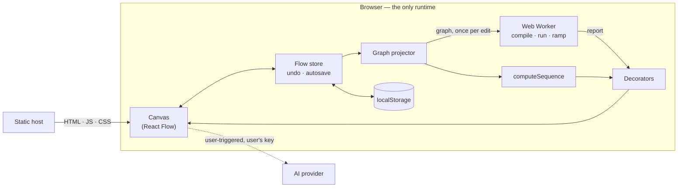

# Nautilus — Project Deep Dive

Everything needed to talk about this project in an interview: what it is, how it
is built, the decisions and their trade-offs, the hard problems, the numbers,
and honest answers to the questions that usually follow.

- [1. The pitch](#1-the-pitch)
- [2. The problem](#2-the-problem)
- [3. What it does](#3-what-it-does)
- [4. Tech stack, and why each piece](#4-tech-stack-and-why-each-piece)
- [5. Architecture](#5-architecture)
- [6. Deep dives](#6-deep-dives)
- [7. Decisions and trade-offs](#7-decisions-and-trade-offs)
- [8. Bugs worth telling as stories](#8-bugs-worth-telling-as-stories)
- [9. Testing and quality](#9-testing-and-quality)
- [10. Numbers to remember](#10-numbers-to-remember)
- [11. Limitations, said plainly](#11-limitations-said-plainly)
- [12. What I would do next](#12-what-i-would-do-next)
- [13. Interview questions and answers](#13-interview-questions-and-answers)
- [14. Algorithms and complexity](#14-algorithms-and-complexity)
- [15. Code map](#15-code-map)

---

## 1. The pitch

**One line.** Nautilus is an open-source system-design canvas where the diagram
is executable: every connection is a numbered request, and you can push traffic
through the design to find where it breaks — entirely in the browser.

**Thirty seconds.** Architecture diagrams are usually pictures. In Nautilus the
diagram is a directed graph with a request model on every edge and a capacity
model on every node. So it can tell you which request goes where and in what
order, which components run on their own as cron jobs or pollers, where the
bottleneck is at 10,000 requests per second, how many replicas fix it and what
that costs per month. There is no backend at all: the simulation runs in a Web
Worker on the user's machine, diagrams live in local storage and plain JSON, and
the AI assistant uses the user's own key. It is a Next.js and React Flow app,
MIT licensed.

**Two minutes — add this.** The interesting engineering is in three places.
First, the *request model*: thirteen operations grouped into four modes —
synchronous call, asynchronous hand-off, consumer pull, timed poll — with an
inference step so unlabelled diagrams still read correctly, and a depth-first
numbering algorithm that defers whatever happens behind a queue until the
request that caused it has finished. Second, the *load model*: a steady-state
analytical model with an M/M/1 queueing approximation that distinguishes three
things most tools blur together — traffic a service drops, backlog a queue
accumulates, and lag a slow consumer leaves behind. Third, *performance*: I
moved the model off the main thread, compiled the graph once per edit, and
stopped the canvas re-rendering on every pointer move, which took a drag on a
336-node diagram from 12.7 seconds to 4.2 under 4× CPU throttling.

## 2. The problem

- A box-and-arrow diagram does not say **what** travels along an arrow, in what
  order, or whether the caller waits. Two people read the same picture
  differently.
- Background work — cron jobs, worker loops, polling — is the part of a system
  that causes the 3am incident, and it is the part diagrams leave out.
- Capacity questions ("does this survive 5× traffic?") are answered by intuition
  in a design review and by an outage in production. Real load testing needs a
  real system; a spreadsheet model is nobody's idea of fun.
- Existing diagram tools want an account, keep your architecture on their
  servers, and export a format you cannot diff.

**Who it is for:** engineers preparing or reviewing a design, people studying
system design, and teams that want a design doc with numbers in it.

## 3. What it does

| Area | Capability |
| --- | --- |
| Canvas | Drag-and-drop from 60+ components in 10 categories; group, align, distribute, copy/paste, undo/redo, keyboard nudging |
| Request model | 13 operations, endpoint or topic, timeout, call order, traffic share, fan-out; unlabelled edges inferred |
| Numbering | Every connection carries a step number and a colour-coded badge |
| Trace | Replay requests one at a time: play, pause, step back/forward, jump, 0.5×–4× |
| Self-starting work | Cron jobs, worker loops, polling connections — counted separately from user traffic |
| Load playground | Utilisation, queue-inflated latency, p95, drops, backlog, consumer lag, bottlenecks, egress bandwidth |
| Capacity and cost | Replica plan to a target utilisation, monthly cost, cost per million requests, one-click apply |
| Load ramp | Offered vs delivered curve, the knee, the safe load, where p95 breaches the budget |
| Failure injection | Take a node down; pin a baseline and see deltas |
| Templates | Netflix, Uber, WhatsApp, Instagram, YouTube, Spotify, Zomato, three-tier, microservices |
| AI assistant | Bring-your-own-key for OpenAI, Gemini, Claude, Groq; design, extend, review, explain |
| Sharing | JSON, PNG, URL-encoded share links, Markdown capacity report |
| Distribution | Web, `npx`, Electron desktop build, self-hosted static or Node |

## 4. Tech stack, and why each piece

| Choice | Why | What I gave up |
| --- | --- | --- |
| **Next.js 16, App Router** | Prerendered marketing and docs pages with good SEO, file-based routing, one deploy target. Every route is static. | It is more framework than a pure client app needs; a Vite SPA would also work. |
| **React 19** | `useSyncExternalStore` for the canvas store; concurrent rendering. | — |
| **TypeScript** | The simulation has a dozen interlocking numeric fields; types catch unit and shape mistakes. | — |
| **React Flow v11** | Mature node-graph canvas: pan, zoom, handles, selection, minimap. | It reconciles every mounted node per change, which is the remaining performance ceiling. v12 improves this. |
| **Web Worker** | Keeps the model off the main thread; nothing to deploy. | Results must be structured-cloneable; debugging is slightly harder. |
| **Tailwind 4 + shadcn/ui (Radix)** | Accessible primitives I own the source of, consistent styling. | — |
| **lz-string** | Compresses a whole diagram into a URL for server-less sharing. | Long diagrams make long URLs. |
| **Vitest** | Fast, TypeScript-native, runs the pure modules in Node. | No component tests. |
| **Electron (optional)** | A native window around the same app, so desktop and web cannot drift. | Large binary. |
| **No backend** | Zero running cost, private by default, trivial self-hosting. | No accounts, no collaboration, keys in the browser. |

## 5. Architecture



**Three layers:**

1. **Pure core** — `flow-ops`, `flow-execution`, `simulation-model`,
   `sim-engine`, `diagram-io`. No React, no DOM. Runs in the page, in a worker
   and in Node under test.
2. **Glue** — the graph projector, the worker transport hook, the render-time
   decorators, the trace playback hook.
3. **UI** — canvas, toolbar, sidebars, simulation panel.

**Two invariants:**

- *Simulation output never enters the document.* It is merged into nodes and
  edges at render time and discarded. Otherwise it would leak into undo history,
  autosave, exports and share links.
- *A drag changes nothing a simulator can see.* The projector returns the same
  graph object until something structural changes, and everything downstream is
  memoised on that object.

The longer version is [docs/ARCHITECTURE.md](docs/ARCHITECTURE.md).

## 6. Deep dives

### 6.1 The request model

An edge used to mean "A depends on B". Now it means a specific interaction,
drawn from the component that **initiates** it.

| Mode | Operations | Who waits |
| --- | --- | --- |
| `sync` | GET POST PUT PATCH DELETE CALL READ WRITE QUERY | The caller |
| `async` | PUBLISH EVENT | Nobody — a hand-off |
| `pull` | CONSUME | The consumer pulls at its own pace |
| `poll` | POLL | The source asks on a timer |

Thirteen names for the reader, **four modes for the engine**. That split is the
design: the simulator only branches on mode, so adding a `HEAD` or a `GRPC`
operation is one line in a table.

**Backward compatibility by inference.** Existing diagrams and all templates had
no operations. Rather than migrate data, `resolveFlow` infers one: explicit
wins; a legacy async flag becomes EVENT; out of a queue is CONSUME; into a queue
is PUBLISH; into a database is QUERY; into a cache is READ; otherwise CALL.
Nothing on disk changed and every old diagram reads correctly.

**Self-starting work.** A node can carry a schedule:

- *cron* fires once per interval no matter how many replicas exist;
- *worker* is a loop every replica runs, so its rate scales with replicas.

`rate = (worker ? replicas : 1) × batch × 1000 / everyMs`

That distinction matters: scaling a cron service to ten replicas does not run the
job ten times, but scaling a polling worker to ten replicas does make ten times
the calls.

### 6.2 Numbering every request

The question is "which request goes where, in what order?" A topological sort
is the wrong answer — it gives layers, and real requests are not layered.

The algorithm (`computeSequence`):

1. Start at each traffic entry point.
2. Walk **depth-first**, because a handler makes its calls in order and waits on
   each. Siblings are sorted by explicit call order, then by draw order.
3. Descend immediately through `sync` and `pull` edges.
4. For `async` and `poll` edges, number the hop where it is issued but put the
   far side on a **pending list**, walked only after the current request has
   finished. A publish returns immediately; the consumer runs later.
5. Then scheduled flows; then anything only reachable through a cycle.

Each hop gets a trigger string — `on request`, `on message`, `after step 4`,
`polls every 30s`, `cron every 5m × 200`.

Details that come up: an explicit stack in place of recursion (a 2,000-node
chain must not overflow), every edge numbered exactly once including in cycles,
and `O(V + E log E)` from sorting siblings.

### 6.3 The load model

A **steady-state analytical model**, not a discrete-event simulation. One pass
in dependency order.

```
offered     = entry share + self-started rate + Σ incoming
capacity    = perReplica × replicas            (0 if failed)
servable    = min(offered, capacity)
excess      = offered − capacity
forwarded   = servable × (1 − errorRate) × (1 − cacheHitRate)
```

**Queueing.** M/M/1 wait: `Wq = S × ρ / (1 − ρ)`. Utilisation is capped at 0.99
and wait at 50× service time, so a stalled node shows a big number, not
infinity.

**Percentiles.** M/M/1 sojourn time is exponential, so one hop's p95 is
`ln(20) ≈ 3×` its mean. Along a path I do **not** add percentiles — means add,
variances add (an exponential's variance is its mean squared), and the path p95
is `mean + 1.645 × √variance`. Adding p95s would say every hop is slow at once,
which overstates the tail badly.

**Why analytical and not discrete-event?** It has to re-run on every slider
movement and 24 more times for the ramp, deterministically, in a millisecond or
two. A discrete-event simulation gives variance and transient behaviour but
needs many simulated seconds and many runs to converge. For "where is the
bottleneck and how many replicas fix it", closed-form is the right tool.

**Sizing on demand, not throughput.** A first pass computes what each node
*would* receive if nothing upstream were shedding. Without that, a saturated
gateway hides the demand behind it: you scale the front door and discover the
same problem one hop deeper.

`requiredReplicas = ⌈demand / (perReplicaCapacity × targetUtilisation)⌉`

### 6.4 Drops, backlog and lag are three different things

This was the main logic fix. The old model had two bugs:

- a queue past capacity forwarded **everything** it was given — a broker with
  infinite throughput;
- a consumer slower than its queue was reported as **dropping** messages.

A consumer cannot drop a message it never pulled. So the excess now depends on
who is holding it:

| Holder | Excess becomes | Shown as |
| --- | --- | --- |
| A queue | Backlog; it forwards only what it can serve | `+4.0k/s` on the queue |
| A consumer on a pull edge | Lag, pushed back onto the queue it reads from | Consumer "saturated", queue shows backlog |
| Anything else | Dropped | Red, counted against success rate |

This changes the advice the tool gives. "Notification service is dropping 500
messages a second" sends you looking for data loss. "Kafka's backlog is growing
at 500 a second because the notifier is saturated; six consumers would clear it"
is what is actually happening.

### 6.5 Requests versus pipelines

A hand-off starts a **fresh latency chain**. If an order service publishes to
Kafka and a transcoder takes seven seconds, the user did not wait seven seconds.
So each node tracks the root of its chain: the slowest chain rooted at a traffic
entry is the *request path* and is checked against the timeout budget; the
slowest chain rooted behind a hand-off is the *background pipeline* and is
reported separately.

Per-call response time needs a second pass, **backwards** through the order: a
caller waits for the target plus the slowest thing the target waits on. That is
what lets a single connection say "p95 480 ms against a 250 ms timeout".

### 6.6 Running it in the browser, off the main thread

**What I found.** There was never a server doing this — but the model and its
24-sample ramp ran on the main thread and re-ran whenever the nodes array
changed, which includes every frame of a drag. On a large diagram that was
about 25 model runs per pointer move.

**What I built.**

- `compileGraph` resolves everything that depends only on shape — order, entry
  points, modes, adjacency as integer indexes — once per edit. `runCompiled`
  then works on typed arrays.
- A two-message protocol: `graph` (compile and keep) and `run` (parameters
  only). A slider drag posts five numbers, not the diagram.
- The same engine object runs in a worker or inline. If the worker cannot start
  or its script errors, the transport swaps to inline, replays the graph and
  re-issues the last run.
- **Latest wins.** One run in flight; a newer request overwrites a single queued
  slot. A slow device runs as fast as it can and never works through stale
  slider positions.
- The worker exists only while the playground is open and is terminated on
  close.

Verified in Chrome: during a run the only network request is the static worker
chunk, and there are no CSP violations.

### 6.7 Making the canvas fast

Measured first, then fixed in order of cost.

| Cause | Fix |
| --- | --- |
| Model + ramp on every drag frame | Graph projector: same object until structure changes |
| `JSON.stringify` of the whole diagram per change to de-duplicate undo entries | Snapshots are immutable arrays; compare by reference |
| One undo entry per mouse move | No history for selection, measurement or drag frames; one commit on drag end |
| Every node re-rendered on any change | `memo` on node and edge; decorators return the *same object* for unchanged elements |
| A context value that changed per frame | External store + `useSyncExternalStore`; the context value is the store and never changes |
| Every element mounted | `onlyRenderVisibleElements` |
| A hashed marker config per edge per render | One shared SVG `<marker>` per colour |
| HTML label overlay per edge | Badges drawn as SVG |
| Badges painted when unreadable | Hidden below 0.3× zoom via one class toggle |
| Animations on huge diagrams | Lite mode past 220 elements or on a low-end device |

**The identity trick is the one to explain.** React Flow skips an element whose
object is identical to last time. The decorators keep a cache keyed by element
id holding the source object, a string of everything that affects drawing, and
the output. If source and key match, the cached output is returned. Rates go
into the key *after formatting*, so 1,204/s → 1,207/s — both displayed
`1.2k/s` — does not re-render.

**Result**, 336 nodes / 611 edges, 60 pointer moves, 4× CPU throttle, same zoom:

| | Before | After |
| --- | --- | --- |
| Load playground open — wall | 12.7 s | 4.2 s |
| Load playground open — script | 10.3 s | 1.6 s |
| Playground closed — wall | 6.9 s | 3.8 s |
| Playground closed — script | 4.5 s | 1.4 s |

**The honest ceiling.** With all 947 elements on screen, the drag is still 6.5 s
under that throttle. The remaining cost is React Flow v11 reconciling every
mounted wrapper per change. The next real gain is migrating to v12, not more
memoisation.

### 6.8 State, undo and autosave

- State is React state inside a provider, published through an external store.
  `useFlow()` subscribes; `useFlowActions()` returns stable setters and never
  re-renders the caller.
- Undo is an array of `{nodes, edges}` references in a ref, capped at 50.
  Immutable updates make structural sharing free: unchanged nodes are the same
  objects across snapshots.
- Setters compute the next value from a ref and then set it — not inside the
  React updater. Updaters must be pure and run twice in development.
- Autosave is debounced 600 ms to `localStorage`.

### 6.9 Security when there is no server

The threat is unusual: there is no server to attack, but **API keys sit in
`localStorage`**, so any script execution on the origin is a key-disclosure bug.

- **One validator for every way in.** Imports, share links, stored diagrams and
  AI output all pass through `sanitizeDiagram`, which *builds a new object from
  known fields* — it never copies an unknown key. Types and colours are
  allow-listed, strings capped, numbers must be finite, non-negative and under a
  per-field maximum, 2,000 nodes and 4,000 edges at most.
- **Denial of service by diagram.** A poll interval of zero is infinite load, so
  intervals below 1 ms are rejected.
- **CSP.** No third-party script origins, `connect-src` limited to the four
  provider hosts, workers same-origin, `frame-ancestors 'none'`, `object-src
  'none'`, plus HSTS, `nosniff`, referrer and permissions policies.
- **Strict `script-src` without a server.** Next.js boots pages with inline
  scripts. The standard fix is a nonce, but a nonce is per request, which means
  rendering every page on a server — giving up the static deploy. Since every
  page is prerendered, its inline scripts are known at the end of the build. A
  post-build step hashes them (about 25 hashes over 22 pages) and swaps
  `'unsafe-inline'` for those hashes in the header the host serves. Verified in
  Chrome: an injected `<script>` and an injected `onerror` handler both fail to
  run. The trade-off is that the step edits framework build output and depends
  on where the host puts it: it works under `next start`, but on Vercel it
  finds no prerendered HTML and falls back to the default policy. It first
  shipped failing the build in that case and broke a deploy — hardening should
  degrade, not block, so it now logs and skips.
- **What is left.** `style-src` still allows inline styles (the canvas needs
  them), and keys in `localStorage` are readable by anything that does run on
  the origin, such as a browser extension.
- **Electron.** `contextIsolation`, `sandbox`, no Node integration, external
  navigation handed to the system browser, single-instance lock.

### 6.10 The AI assistant

- Bring-your-own-key, browser to provider. It is the only way to offer AI on a
  free, backend-less tool without a shared quota.
- The system prompt includes a compact description of the canvas — up to 60
  nodes and 120 connections with their operations — so the model can review what
  is actually there. The last 12 turns go as history; 90-second timeout;
  abortable.
- JSON mode where the provider has it; the reply is still parsed defensively.
- Model output is untrusted: validated, auto-laid-out by dependency layer, and
  then **offered** — replace, add, or discard. Never applied automatically.

### 6.11 Sharing with no server

A share link is the diagram: JSON, compressed with lz-string, in a query
parameter. No storage, no expiry, no account. The costs are real and documented:
long diagrams make long URLs, and the link is unlisted rather than private —
anyone with it, or with a proxy log, has the diagram.

## 7. Decisions and trade-offs

| Decision | Alternative | Why this way | Cost |
| --- | --- | --- | --- |
| No backend | Accounts and a database | Zero running cost, privacy, self-hosting in one command | No collaboration, no cloud save |
| Analytical model | Discrete-event simulation | Deterministic, ~1 ms, re-runs on every slider move | No transients, retries or variance |
| M/M/1 on pooled capacity | M/M/c | One closed form, easy to reason about | Less accurate for small replica counts |
| Infer operations | Migrate every diagram | Old diagrams and exports keep working untouched | Inference can guess wrong; the UI marks it "inferred" |
| Web Worker with inline fallback | Main thread only, or worker only | Smooth UI, but never a dead playground when workers are blocked | Two code paths to keep equivalent |
| Latest-wins scheduling | Debounce | Adapts to the device: fast machines update every frame, slow ones skip | Intermediate values are never computed |
| Render-time decoration | Write results into node data | Keeps the document clean and undo honest | An extra mapping step per render, hence the caching |
| Window `CustomEvent`s for toolbar → canvas | Prop drilling or a command bus | Toolbar knows nothing about canvas internals | Untyped, and one event must have exactly one owner |
| External store over context value | Zustand or Redux | No dependency for a small need | Hand-rolled |
| SVG badges | HTML via `EdgeLabelRenderer` | Cheap with hundreds of edges; survives PNG export | Text width is estimated from character count |
| Keys in `localStorage` | A proxy server | No server | Any XSS is a key leak, so validation and CSP matter more |
| Hash-based CSP patched in after the build | Nonce via middleware | Pages stay static; no per-request rendering | Edits framework build output; must be re-checked on upgrades |

## 8. Bugs worth telling as stories

**The consumer that "dropped" messages.** Described in 6.4. The lesson: when a
model produces a number, ask where that quantity physically is. The messages
were in the queue the whole time.

**The cron job that received user traffic.** Entry points were "nodes with no
incoming edges". A cron job has none, so it was handed a share of the offered
load. Fix: a traffic entry has no incoming edges, is not scheduled, and is not a
pure poller.

**The worker pool that could never be big enough.** Sizing a worker loop against
its own demand does not converge — each added replica adds load. Its
self-generated rate is excluded from the sizing demand.

**Paste inserted two copies.** Toolbar events were bound in both the canvas and
the state provider, so every action ran twice and two grouping models fought
each other. Now every `nautilus-*` event has exactly one owner, and that rule is
written into the contributing guide.

**Undo entries doubled in development.** History was pushed from inside a React
state updater. React calls updaters twice in Strict Mode to catch exactly this
impurity. The next value is now computed from a ref, outside the updater.

**The benchmark that lied.** My first before/after comparison showed the new
code as slower. The "before" run had never actually dragged a node — the pointer
events had missed their target — so it measured an idle canvas. Re-running both
versions with the same script at the same zoom gave the real picture. The lesson
I would repeat: make a benchmark prove it did the work — here, that the node's
position changed — before reading its result.

**Opening a node changed its error rate.** Percent fields are stored as
fractions and shown as percentages. Converting to a percentage and back is not
exact in floating point, so merely selecting a node could write a slightly
different number — a phantom edit and an undo entry. The form now keeps the
stored value whenever the text on screen still represents it.

**A menu item that did nothing.** The node context menu's *Edit* dispatched an
event nothing listened for, and its *Delete* removed the node but left its
connections dangling. One handler now owns edit, duplicate and delete, and
delete takes every connection touching the node with it.

**Every template overlapped itself.** All nine were drawn on a 200 × 150 grid,
but a node grows to 320 px wide and about 160 px tall once it has a description
and live metrics — so neighbours covered each other and hid the request badges.
I respaced them and added a test that fails if any two nodes in a template are
closer than a node's footprint.

## 9. Testing and quality

- **113 unit tests, six files**, all on the pure core, running in Node in well
  under a second.
- **Template contract test:** every built-in template must be valid, must
  serve its own rated load without dropping traffic, and must lay out with no
  overlapping nodes. A change to the model that
  quietly breaks a template fails CI.
- **Structured-clone test:** engine results are round-tripped the way
  `postMessage` would, so a `Map` or function in a report is caught.
- **Deep-chain test:** numbering a chain far deeper than the call stack.
- **Browser verification** with a headless Chrome script: numbering, trace,
  worker execution, connection editing, undo/redo behaviour, persistence,
  network requests during a run, console and CSP errors.
- **CI:** lint, type check, tests, production build, and `npm audit` (high severity for production
  dependencies, critical for tooling) — on every push and pull request.

What is not covered: React components have no unit tests, and there is no
committed end-to-end suite — the browser script was a verification tool, not
part of CI.

## 10. Numbers to remember

| | |
| --- | --- |
| Operations / modes | 13 / 4 |
| Palette components / categories | 60+ / 10 |
| Templates | 9 |
| Unit tests | 113 in 6 files |
| Source size | about 16,000 lines of TypeScript, excluding tests |
| Ramp samples | 24, up to 2× current load |
| Model run + ramp, small diagram | 1–2 ms in the worker |
| Drag benchmark, playground open | 12.7 s → 4.2 s wall; 10.3 s → 1.6 s script |
| Benchmark setup | 336 nodes, 611 edges, 60 moves, 4× CPU throttle |
| Undo depth | 50 |
| Autosave debounce | 600 ms |
| Import limits | 2,000 nodes, 4,000 edges, 2,000 characters per text field |
| Lite mode threshold | 220 elements, or ≤ 4 cores / ≤ 4 GB / reduced motion |
| Minimap dropped | past 400 nodes (120 on low-end devices) |
| Badges hidden | below 0.3× zoom |
| Status thresholds | warn ≥ 60%, saturated ≥ 85%, overloaded > 100% |
| p95 of one hop | ln(20) ≈ 3× mean |
| Hours per month for cost | 730 |
| AI context | 60 nodes, 120 edges, last 12 turns, 90 s timeout |
| Servers involved in a simulation | 0 |

## 11. Limitations, said plainly

- **It is a model, not a measurement.** Endpoints are labels; nothing is called.
- **Steady state only.** No retries, circuit breakers, cold starts, autoscaling
  lag or time-varying load beyond a burst multiplier.
- **M/M/1 is an approximation.** Real arrivals are burstier than Poisson and a
  replica pool is M/M/c. Good for finding bottlenecks; wrong for predicting p99.
- **Load splits evenly across entry points.**
- **Cycles are undefined** in the load model and reported, not solved.
- **Very large diagrams** are bounded by React Flow v11's reconciliation.
- **No collaboration, no accounts, no server backup.**
- **Keys in `localStorage`;** the strict script policy depends on a post-build
  step that patches framework output.
- **Desktop-first editor;** no component or end-to-end tests in CI.

Saying these first, before being asked, is the strongest way to present the
project.

## 12. What I would do next

1. **`@xyflow/react` v12** — the biggest remaining performance gain.
2. **Retries and circuit breakers on connections** — retry storms are the most
   common real failure the model cannot show.
3. **M/M/c**, or an optional discrete-event mode for tail latency.
4. **Per-entry-point traffic weights**, replacing the even split.
5. **Encrypt stored keys** with a passphrase-derived key (WebCrypto), so a
   stolen `localStorage` dump is not enough.
6. **Playwright suite in CI**, starting from the verification scripts.
7. **Optional sync** — an end-to-end-encrypted blob store or CRDT collaboration,
   keeping local-first as the default.
8. **SVG/PDF export and left-to-right layout.**

## 13. Interview questions and answers

**Why no backend?**
Because the product does not need one, and removing it removes cost, an entire
class of privacy questions, and all operational work. The costs are no
collaboration and keys living in the browser; I accepted both and compensated
for the second with validation and CSP.

**How does the simulation actually work?**
Compile the graph to index-addressed arrays, then one pass in topological
order: each node's offered load is its entry share plus self-started work plus
what its sources forwarded. Capacity caps what it serves; M/M/1 gives the queue
wait; the excess becomes drops, backlog or lag depending on the node. A second
backward pass gives each call's response time.

**Why M/M/1? Is that realistic?**
It is the simplest model that produces the behaviour that matters — latency
rising sharply as utilisation approaches one. It assumes Poisson arrivals and
exponential service, and I treat a replica pool as one server, so it is not
accurate for tails. It is accurate enough to say "this node is the bottleneck"
and "you need about this many replicas", which is the tool's job.

**Why not just add up the p95s along a path?**
Because it assumes every hop is at its 95th percentile simultaneously. Means and
variances are additive for independent hops; percentiles are not. I sum both and
take the percentile of the result.

**What happens with a cycle?**
Kahn's algorithm leaves cyclic nodes with non-zero in-degree. They are reported,
appended as a final step, and their inbound traffic is treated as unknown. The
numbering still visits every edge exactly once. A fixed-point iteration could
solve it; I chose to report it honestly.

**How do you keep the worker and the main thread from fighting?**
The worker owns the compiled graph. The main thread sends `graph` when structure
changes and `run` with parameters. Each run has a sequence number; only one is
in flight; a newer request replaces the queued one.

**Why latest-wins and not debounce?**
Debounce picks a delay for everyone. Latest-wins adapts: a fast machine updates
every frame, a slow one skips intermediate values, and neither ever processes a
stale position.

**What if Web Workers are unavailable?**
The same engine runs inline. Construction is wrapped in `try`, and `onerror`
triggers a swap that replays the graph and the last request. The panel shows
which mode ran.

**How did you find the performance problems?**
Chrome's performance profile under CPU throttling, on a generated 336-node
diagram, with a scripted drag so runs were comparable. The profile showed three
things: model runs per frame, `JSON.stringify` in undo, and every node
re-rendering. I fixed those, re-measured, and kept going until what was left was
inside the canvas library.

**Why did every node re-render when one moved?**
Three compounding reasons: the decorator created new objects for every node on
every render, the node component read from a context whose value changed per
frame, and components were not memoised. Fixing only one would not have helped —
memo is useless if props are new objects each time.

**Why an external store and not just context?**
A changing context value makes React traverse into memoised subtrees looking for
consumers. With `useSyncExternalStore`, the context value is the stable store
and only subscribers re-render.

**How does undo work without copying the diagram?**
Updates are immutable, so a snapshot is two array references. Unchanged nodes
are shared between snapshots. De-duplication is a reference comparison.

**How do you handle untrusted input?**
One function for all four sources. It constructs a clean object from an
allow-list of fields and never spreads the input. Numbers are bounded, strings
capped, ids de-duplicated, dangling edges dropped. It returns notes about what
it repaired.

**Isn't storing API keys in `localStorage` insecure?**
It is a trade-off, and I document it. With no server there is nowhere else to
put them. The mitigations are: no third-party scripts, a `connect-src`
allow-list so an injected script could not exfiltrate to an arbitrary host,
strict validation of everything rendered, and advice to use scoped keys with
spend limits. And `script-src` allows only the hashed inline scripts the build
emitted, so an injected inline script does not execute.

**How does the AI avoid corrupting the canvas?**
Its output is treated exactly like an imported file: validated, laid out, and
shown as a proposal the user accepts or discards. Replacing the canvas is one
undo step.

**How would this scale to 10,000 nodes?**
The model would be fine — it is linear and runs in a worker. The canvas would
not: React Flow reconciles every mounted node. I would move to v12, and beyond
that a canvas or WebGL renderer with level-of-detail, which is a different
product.

**How would you add real-time collaboration?**
The document is already plain JSON with stable ids, which suits a CRDT such as
Yjs: a map of nodes and a map of edges. Simulation state is already kept out of
the document, so nothing transient would sync. It needs a relay server, which is
the real decision — it ends "no backend".

**What was the hardest part?**
Getting the semantics right, not the code. Deciding that a consumer's overflow
is the queue's backlog, that a publish ends the request's latency chain, and
that a cron job is not a traffic entry — each was a modelling decision that
changed what the tool tells you.

**What would you do differently?**
Start with the request model. I built the capacity model on edges that meant
"depends on" and retrofitted meaning onto them through inference. It works, but
explicit operations from day one would have made the templates more honest.

**What are you most proud of?**
That the numbers are defensible. Every figure in the panel has a formula I can
write on a whiteboard, and the limits of each are in the docs.

**How do you know it is correct?**
Unit tests pin the arithmetic — conservation of traffic, M/M/1 values, the
drop/backlog/lag split, percentile combination — and the template suite checks
nine real designs end to end. What tests cannot prove is that the *model*
matches reality; that is why it is labelled a model everywhere.

## 14. Algorithms and complexity

| Function | Algorithm | Complexity |
| --- | --- | --- |
| `computeExecutionPlan` | Kahn's topological sort, layered; leftovers are the cycle | `O(V + E)` |
| `computeSequence` | Iterative DFS with a deferred queue for hand-offs | `O(V + E log E)` |
| `compileGraph` | One pass; id → index map; adjacency as index arrays | `O(V + E)` |
| `runCompiled` | Demand pass, forward pass, backward pass over typed arrays | `O(V + E)` |
| `sweepCompiled` | 24 runs on the same compiled graph | `O(24 · (V + E))` |
| `sanitizeDiagram` | Single pass with sets for duplicate detection | `O(V + E)` |
| Graph projector | Pairwise reference comparison | `O(V + E)`, no allocation when unchanged |
| Decorators | Map lookup per element, cached output | `O(V + E)`, few allocations |
| `autoLayout` | Rows from the planner's layers | `O(V + E)` |

## 15. Code map

| To explain… | Open |
| --- | --- |
| The request model and numbering | `src/lib/flow-ops.ts` |
| The load model | `src/lib/simulation-model.ts` |
| The worker protocol | `src/lib/sim-engine.ts`, `src/lib/sim-worker.ts` |
| Latest-wins and the inline fallback | `src/lib/use-load-engine.ts` |
| Why a drag is free | `src/lib/sim-graph.ts`, `src/lib/canvas-decorate.ts` |
| Store, undo, autosave, share links | `src/lib/flow-context.tsx` |
| Input validation | `src/lib/diagram-io.ts` |
| Canvas wiring | `src/components/canvas.tsx` |
| The numbered badge | `src/components/edges/deletable-edge.tsx` |
| The connection form | `src/components/edge-inspector.tsx` |
| CSP and headers | `next.config.ts` |
| The `npx` launcher and desktop shell | `bin/server.mjs`, `desktop/main.js` |
| Tests | `src/lib/__tests__/` |
