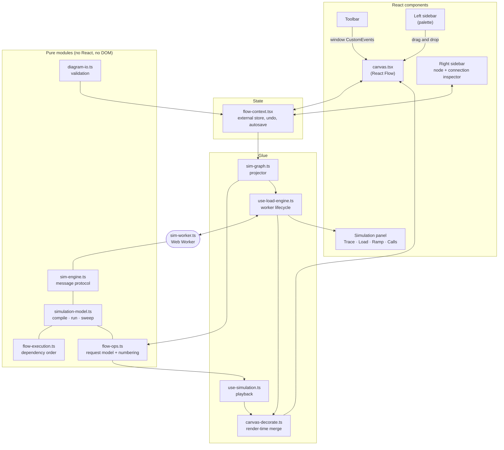

# Nautilus — Architecture

How the code is organised, why it is organised that way, and how the numbers the
simulators report are produced.

- [The one constraint](#the-one-constraint)
- [System overview](#system-overview)
- [The document](#the-document)
- [State and history](#state-and-history)
- [From canvas state to a simulation](#from-canvas-state-to-a-simulation)
- [The request model](#the-request-model)
- [Step numbering](#step-numbering)
- [The load model](#the-load-model)
- [The engine and its worker](#the-engine-and-its-worker)
- [Rendering and performance](#rendering-and-performance)
- [Persistence and sharing](#persistence-and-sharing)
- [Untrusted input](#untrusted-input)
- [The AI assistant](#the-ai-assistant)
- [Security headers](#security-headers)
- [Launcher and desktop shell](#launcher-and-desktop-shell)
- [Testing](#testing)
- [Extending it](#extending-it)

---

## The one constraint

**Nothing runs on a server.** There are no route handlers, no server actions, no
database and no environment variables. Every page is prerendered; the deployed
site hands out HTML, JavaScript and CSS, and everything after that happens in
the visitor's browser.

Most of the design follows from that:

| Because there is no server… | …the app does this |
| --- | --- |
| Nowhere to store diagrams | `localStorage` autosave, JSON export, and share links that carry the whole diagram in the URL |
| Nowhere to run a simulation | A pure model that runs in a Web Worker |
| Nowhere to keep a shared AI key | Bring-your-own-key, browser to provider |
| Keys therefore live in the browser | A restrictive Content-Security-Policy and one validator for every untrusted input |
| Nothing to operate | Hosting is a static deploy; self-hosting has no configuration |

## System overview



Two rules keep this manageable:

1. **Everything that computes is pure.** `flow-ops`, `flow-execution`,
   `simulation-model`, `sim-engine` and `diagram-io` import no React and touch
   no DOM. They run identically in the page, in a worker and in Node under test.
2. **Simulation output never enters the document.** Results are merged into
   nodes and edges at render time and thrown away. Anything written into node
   state lands in undo history, autosave, exports and share links.

## The document

```ts
type Diagram = {
  name?: string
  nodes: Node[]   // { id, type, position, data: { label, icon, color, description, sim } }
  edges: Edge[]   // { id, source, target, label?, data: { flow, sim } }
  sim?: LoadParams
}
```

| Where | Field | Meaning |
| --- | --- | --- |
| `node.data.sim` | `capacity` | Requests per second one replica serves. Absent means unbounded. |
| | `replicas` | Identical instances. |
| | `latencyMs` | Service time before queueing. |
| | `errorRate` | Baseline failure probability, 0–1. |
| | `hitRate` | Share answered here and not forwarded (a cache). |
| | `costPerHour` | Price of one replica per hour. |
| | `queue` | Buffers past capacity instead of shedding. Inferred from the icon. |
| | `down` | Failure injection. |
| | `schedule` | `{ kind: "cron" \| "worker", everyMs, batch }` — work the node starts itself. |
| `edge.data.flow` | `op` | One of the 13 operations. Absent means inferred. |
| | `path` | Endpoint, topic, table or key. Descriptive only. |
| | `order` | Position among the source's outgoing calls. |
| | `intervalMs` | `POLL` only: time between polls, per replica. |
| | `timeoutMs` | How long the caller will wait. |
| `edge.data.sim` | `share` | Fraction of the source's traffic taking this edge. |
| | `fanout` | Calls made per request. |
| top-level `sim` | `requestsPerSecond`, `timeoutMs`, `payloadKb`, `targetUtilization`, `burstFactor` | Playground parameters, saved with the diagram. |

Group nodes (`type: "groupNode"`) are visual containers and are excluded from
every computation.

## State and history

`src/lib/flow-context.tsx` owns the document.

**A store, not a context value.** The provider holds React state, but publishes
it through a small external store read with `useSyncExternalStore`. The context
value is the store object itself, which never changes. A context value that
changes on every mouse move makes React walk the subtree of every memoised
component below it looking for consumers — under a canvas that is every node on
screen, per frame. With a store, only components that subscribed are visited.

- `useFlow()` subscribes; the caller re-renders when canvas state changes.
- `useFlowActions()` returns setters with a stable identity and never causes a
  re-render. Components that only write use this.

**History by reference.** Snapshots are the immutable `nodes` and `edges` arrays
themselves, so "did anything change?" is an identity check. Setters take
`{ history: false }` for changes that are not edits — selection, measured sizes,
and the intermediate frames of a drag. A drag commits once, when it ends. History
is capped at 50 entries and lives in a ref, so recording it re-renders nothing.

**Setters compute outside the updater.** The next value is derived from a ref
and then set, not computed inside a React state updater. Updaters must be pure,
and React invokes them twice in development; doing history bookkeeping inside
one used to duplicate entries.

**Toolbar to canvas by events.** Toolbar buttons dispatch `nautilus-*`
`CustomEvent`s on `window` and the canvas listens. It keeps the toolbar free of
canvas internals. The rule that comes with it: every event has exactly one
owner. See [CONTRIBUTING.md](../CONTRIBUTING.md#how-components-talk-to-each-other).

## From canvas state to a simulation

Canvas state changes constantly — positions during a drag, selection flags,
measured sizes — and none of it matters to a simulation.

`createGraphProjector()` (`sim-graph.ts`) maps canvas state to a `SimGraph`
containing only the fields the model reads, and **returns the same object as
last time** unless something structural changed. The check is cheap: moving or
selecting a node replaces the node object but keeps its `data` reference, so
comparing `id`, `type` and `data` per node is enough.

Everything downstream is memoised on that object:

```
nodes, edges ──projector──▶ SimGraph ──┬─▶ computeSequence ─▶ step numbers
   (changes per frame)   (stable)      └─▶ worker.setGraph ─▶ compiled graph
```

So during a drag: no numbering, no message to the worker, no model run.

## The request model

`src/lib/flow-ops.ts`. A connection is drawn from the component that
**initiates** the interaction to the one that receives it.

| Mode | Operations | Meaning |
| --- | --- | --- |
| `sync` | `GET` `POST` `PUT` `PATCH` `DELETE` `CALL` `READ` `WRITE` `QUERY` | The source calls and waits for the reply. |
| `async` | `PUBLISH` `EVENT` | The source hands off and moves on. |
| `pull` | `CONSUME` | The target pulls from the source at its own pace. |
| `poll` | `POLL` | The source hits the target on a timer, whatever traffic it is serving. |

The mode is what the simulators act on; the operation name and colour are for
the reader.

**Inference.** `resolveFlow` gives an unlabelled edge an operation so that
diagrams drawn before the request model existed still read correctly:

1. an explicit `flow.op` wins;
2. legacy `sim.async: true` → `EVENT`;
3. source is a queue → `CONSUME`;
4. target is a queue → `PUBLISH`;
5. target is a database → `QUERY`; a cache → `READ`;
6. otherwise `CALL`.

**Self-starting work.** A node's `schedule` is either `cron` (fires once per
interval, however many replicas exist) or `worker` (every replica loops):

```
rate = (kind == worker ? replicas : 1) × batch × 1000 / everyMs
```

A `POLL` edge issues `replicas(source) × fanout × 1000 / intervalMs` calls per
second, and stops if the poller is down.

**Entry points.** User traffic enters at nodes with no incoming edges that are
neither scheduled nor pure pollers (`isTrafficEntry`). Without that rule a cron
job, which has no callers, would be handed a share of the offered load.

## Step numbering

`computeSequence` answers "which request goes where, in what order?".

- From each entry point, follow outgoing edges **depth-first** — a handler makes
  its calls in order and waits on each, so that is the order they happen in.
- Siblings are sorted by explicit `order`, then by the order they were drawn.
- `sync` and `pull` edges are descended into immediately.
- `async` and `poll` edges are numbered where they are issued, but the far side
  goes on a **pending list** and is walked only after the current request has
  finished — because that is how it plays out in production.
- Then flows that start themselves (scheduled nodes), then anything reachable
  only through a cycle.

Each hop records its trigger: `on request`, `on message`, `after step 4`,
`polls every 30s`, `cron every 5m × 200`.

The walk uses an explicit stack, so a 2,000-node chain cannot overflow the call
stack. Complexity is `O(V + E log E)` — the log from sorting siblings.

The older `flow-execution.ts` planner (Kahn's algorithm, layered) is still used
for what it is good at: dependency order for the load model, cycle detection,
and row assignment for auto-layout.

## The load model

`src/lib/simulation-model.ts`. A steady-state analytical model — one pass over
the graph in dependency order — not a discrete-event simulator. It is built to
expose capacity mistakes and bottlenecks, not to predict a p99.

### Compile, then run

```ts
compileGraph(nodes, edges): CompiledGraph   // O(V + E), once per edit
runCompiled(graph, params): SimulationReport // O(V + E), per run
sweepCompiled(graph, params): RampResult     // 24 × runCompiled
```

Compilation settles everything that depends only on the graph's shape:
dependency order, entry points, inferred modes, poll rates, adjacency as integer
indexes. A run then works on typed arrays (`Float64Array`, `Int32Array`,
`Uint8Array`) indexed by node and edge, with no map lookups in the hot loop.

### One pass, per node

```
peak        = requestsPerSecond × burstFactor
entryLoad   = peak / entryCount

offered     = (entry ? entryLoad : 0) + selfRate
            + Σ incoming edges:
                poll  → pollRate
                else  → forwarded[source] × share × fanout

capacity    = down ? 0 : perReplicaCapacity × replicas
servable    = min(offered, capacity)
excess      = max(0, offered − capacity)

forwarded   = servable × (1 − errorRate) × (1 − hitRate)
utilisation = offered / capacity
```

**What happens to the excess depends on who is holding it:**

| Node | Excess becomes |
| --- | --- |
| A queue | **Backlog** — it buffers and falls behind. It forwards only what it can serve. |
| A consumer on a `pull` edge | **Lag** — it never took those messages, so they are still in the queue it reads from. The amount is pushed back onto that queue as backlog; the consumer shows as saturated, not as dropping. |
| Anything else | **Dropped** — it was sent requests it could not serve. |

### Latency

Queue wait uses the M/M/1 result `Wq = S × ρ / (1 − ρ)`, with utilisation capped
at 0.99 and the wait capped at 50× the service time so a stalled node reports a
large number, not infinity:

```
queueMs   = latencyMs × ρ / (1 − ρ)
latencyMs = serviceMs + queueMs
```

Sojourn time in an M/M/1 queue is exponentially distributed, so a single hop's
95th percentile is `ln(20) ≈ 3×` its mean.

Along a path, percentiles are **not** added. Means add; variances add (the
variance of an exponential is its mean squared); and the path percentile is taken
with a normal approximation:

```
pathMean = Σ latency
pathVar  = Σ latency²
pathP95  = pathMean + 1.645 × √pathVar
```

The p95 of a chain is well below the sum of each hop's p95, because hops rarely
all go slow at once.

A hand-off (`async` or `poll`) **starts a fresh latency chain**: nobody upstream
is still waiting, so their time is not part of that path. The slowest chain
rooted at a traffic entry is the *request path* and is checked against the
timeout budget; the slowest chain rooted behind a hand-off is reported
separately as the *background pipeline*.

### Per-call response time

A second pass walks the order **backwards**: a caller waits for its target plus
the slowest thing the target itself waits on.

```
subtree[i] = latency[i] + max over sync out-edges of subtree[target]
```

For a `sync` edge the response time is `subtree[target]`; for a hand-off it is
only the target's own latency (the broker's acknowledgement). An edge with a
`timeoutMs` is flagged when its p95 exceeds it.

### Capacity and cost

Sizing uses **demand**, not throughput. A first pass computes what each node
*would* receive if nothing upstream were shedding load or switched off;
otherwise a saturated gateway hides the demand on everything behind it.

```
requiredReplicas = ⌈ demand / (perReplicaCapacity × targetUtilization) ⌉
monthlyCost      = costPerHour × replicas × 730
costPerMillion   = monthlyCost / (delivered × 3600 × 730 / 10⁶)
```

A worker loop's own jobs are excluded from its sizing demand — they grow with
every replica added, so sizing against them would never converge.

### Load ramp

`sweepCompiled` runs the model at 24 evenly spaced loads up to twice the current
setting (minimum 1,000 req/s) and reports:

- the **knee** — the first load where fewer than 99.9% of calls are served or a
  backlog starts growing;
- the **safe load** — the highest sample still clean;
- the load at which the request path's p95 first breaches the timeout.

### Known simplifications

- A replica pool is treated as one fast server (M/M/1 on pooled capacity), not
  M/M/c.
- Offered load is split evenly across entry points.
- No retries, circuit breakers, cold starts, or time-varying load beyond the
  burst multiplier.
- Traffic through a cycle is undefined; cyclic nodes are reported.

## The engine and its worker

`sim-engine.ts` wraps the model in a two-message protocol:

```ts
type EngineRequest =
  | { type: "graph"; nodes; edges }                       // compile and keep
  | { type: "run"; seq; params; rampMaxRps }              // run + ramp

type EngineResponse =
  | { type: "result"; seq; report; ramp; ms; nodeCount; edgeCount }
  | { type: "error"; seq; message }
```

The same `createEngine()` runs in two places: inside `sim-worker.ts`, and inline
on the main thread when a worker cannot be created or its script fails to load.
Either way it is on the user's machine.

`use-load-engine.ts` owns the transport:

- **Lifecycle.** The worker exists only while the playground is open. Closing it
  calls `terminate()`.
- **Graph once.** The diagram crosses to the worker only when the projector
  hands out a new `SimGraph`. A slider drag sends parameters only.
- **Latest wins.** At most one run is in flight. A request that arrives
  meanwhile overwrites a single `queued` slot; when the current run settles, the
  queued one is dispatched. A slow machine runs the model as fast as it can and
  never builds a queue of stale work behind the pointer.
- **Fallback.** `worker.onerror` swaps in the inline engine, replays the graph
  and re-issues the last run. The inline path still yields with `setTimeout(0)`
  so a burst of slider events collapses into one run.

## Rendering and performance

The canvas is React Flow v11. The cost that matters is not the model — it is
React reconciling nodes and edges on every pointer move.

| Technique | Where | Effect |
| --- | --- | --- |
| Stable `SimGraph` | `sim-graph.ts` | A drag never re-numbers or re-simulates. |
| Identity-preserving decorators | `canvas-decorate.ts` | A node or edge whose source object and decoration inputs are unchanged gets the *same* output object, so React Flow skips it. |
| `memo` on node and edge components | `NautilusNode`, `DeletableEdge` | Only the dragged node re-renders. |
| Store subscription | `flow-context.tsx` | Unrelated components are not visited per frame. |
| No history on drag frames | `canvas.tsx` | No per-move snapshot; one commit on drag end. |
| `onlyRenderVisibleElements` | `canvas.tsx` | Off-screen elements are not mounted. |
| Shared `<marker>` definitions | `flow-markers.tsx` | One arrowhead per colour, not a hashed marker config per edge per render. |
| SVG badges | `deletable-edge.tsx` | No HTML overlay per connection; badges survive PNG export. |
| Zoom-out culling | `flow-markers.tsx`, `canvas.css` | Below 0.3× zoom a `canvas-far` class hides badges that could not be read. |
| Lite mode | `canvas.tsx` | Past 220 elements, or on a device with ≤ 4 cores, ≤ 4 GB, or reduced motion: no animated edges, no glow filters. The minimap is dropped past 400 nodes (120 on low-end devices). |

The decorator's cache key for an edge is a string of everything that affects how
it is drawn (step, operation, path, trace mark, formatted rate and response,
flags). Rates are compared *after* formatting, so a rate moving from 1,204/s to
1,207/s — both shown as `1.2k/s` — does not re-render the edge.

## Persistence and sharing

| Mechanism | How |
| --- | --- |
| Autosave | Debounced 600 ms after the last change, to `localStorage` key `nautilus-canvas-v1`. |
| Export / import | The JSON document, as a file. |
| Share link | `lz-string` compresses the document into `?d=…`. No server; the URL *is* the diagram. |
| PNG | `html-to-image` renders the canvas at 2× pixel ratio. |
| Capacity report | Markdown generated from the latest run, copied to the clipboard. |

Load order on startup: a `?d=` share link wins, then `localStorage`, then a
two-node starter diagram.

## Untrusted input

Four things arrive from outside: imported files, share links, `localStorage`
written by an older version, and model output. All four go through
`sanitizeDiagram` (`diagram-io.ts`), which builds a new object from known fields
only — it never copies an unknown key.

- Node types are checked against an allow-list; colours too.
- Strings are length-capped; every number must be finite, non-negative and under
  a per-field maximum.
- At most 2,000 nodes and 4,000 edges.
- Duplicate node ids are dropped; duplicate edge ids are renamed; edges to
  missing nodes are dropped.
- A schedule or poll interval below 1 ms is rejected — an interval of zero is
  infinite load.
- Transient render keys (`__simStatus`, `__metrics`, `__flow`) never survive.

The function returns notes describing what it repaired, and throws only when
there are no `nodes`/`edges` arrays at all.

## The AI assistant

`ai-client.ts` calls OpenAI, Gemini, Anthropic and Groq directly from the
browser with a key the user pasted in.

- The system prompt carries a compact description of the canvas (up to 60 nodes
  and 120 connections, with their operations), so the model can review or extend
  what is actually there.
- The last 12 turns are sent as history. Requests time out after 90 s and can be
  aborted.
- JSON mode is requested where the provider supports it; the reply is still
  parsed defensively (fenced block, first balanced object, last object).
- Output goes through `sanitizeDiagram`, then `autoLayout` (rows from the
  dependency planner), and is **offered** — replace, add, or discard. It is never
  applied automatically.

## Security headers

Set in `next.config.ts` for every route:

| Header | Value |
| --- | --- |
| `Content-Security-Policy` | `default-src 'self'`; `script-src 'self'` plus build-time hashes; `connect-src 'self'` plus the four provider hosts; `worker-src 'self' blob:`; `frame-ancestors 'none'`; `object-src 'none'`; `base-uri 'self'`; `form-action 'self'` |
| `Strict-Transport-Security` | Two years, subdomains, preload |
| `X-Frame-Options` | `DENY` |
| `X-Content-Type-Options` | `nosniff` |
| `Referrer-Policy` | `strict-origin-when-cross-origin` |
| `Permissions-Policy` | Camera, microphone, geolocation off |

`script-src` blocks every third-party script origin, and `connect-src` means an
injected script could not send a key anywhere except the four provider hosts.
`'unsafe-eval'` is allowed in development only.

**Inline scripts without a server.** Next.js boots every page with a few inline
scripts, so `script-src` has to allow them somehow. The usual answer is a nonce,
but a nonce must be fresh per request, which forces every page to be rendered on
a server for every visitor — the opposite of this app's one constraint. Because
every page is prerendered, its inline scripts are fully known when the build
ends. So `npm run build` is `next build && node scripts/csp-hashes.mjs`: the
script hashes every inline script in the prerendered HTML (25 hashes across 22
pages) and rewrites the `script-src` directive in `.next/routes-manifest.json`,
replacing `'unsafe-inline'` with those hashes. `next.config.ts` keeps
`'unsafe-inline'` as the starting value, so a build that skips the step still
works, just with the looser policy.

The cost: the step edits framework build output, so it is the piece most likely
to need attention on a Next.js upgrade. It exits non-zero if it finds no pages
or no policy to patch, so that failure is loud.

A static export cannot send these headers — they have to be re-created at the
CDN.

## Launcher and desktop shell

- `bin/nautilus.mjs` + `bin/server.mjs` — the `npx` entry point. Builds once if
  there is no `.next/BUILD_ID`, finds a free port, starts `next start` bound to
  `127.0.0.1`, waits until it answers, opens the browser, and kills the child on
  exit.
- `desktop/main.js` — an Electron shell that starts the same local server and
  points a window at it, so the desktop and web builds cannot drift. The
  renderer runs with `contextIsolation`, `sandbox` and no Node integration;
  navigation away from the local server opens in the system browser; a
  single-instance lock means a second launch focuses the first window.

## Testing

Vitest, Node environment, 113 tests in six files:

| File | Covers |
| --- | --- |
| `simulation-model.test.ts` | Capacity, queueing, drops vs backlog vs lag, percentiles, cost, ramp, scheduled load, per-edge metrics |
| `flow-ops.test.ts` | Inference, schedule rates, numbering order, hand-off deferral, cycles, deep chains |
| `sim-engine.test.ts` | The message protocol, graph reuse across runs, results that survive structured cloning, and the graph projector |
| `flow-execution.test.ts` | Layering, cycles, dangling edges, groups |
| `diagram-io.test.ts` | Dropping unknown fields, clamping, schedules and flows, limits |
| `templates.test.ts` | Every built-in template is valid, serves its rated load cleanly, and lays out without overlapping nodes |

The components are not unit-tested; canvas behaviour is verified in a real
browser.

## Extending it

| To add… | Touch |
| --- | --- |
| A template | One file in `src/lib/templates/`, one line in `index.ts` |
| An icon | `node-icons.tsx`, optionally the palette and `ai-schema.ts` |
| An operation | `FLOW_OPS` and `OP_META` in `flow-ops.ts`; the inspector and badge colours follow |
| A node parameter | `NodeSimConfig` → `compileGraph` → `runCompiled` → `sanitizeNodeSim` → the Properties form → a test |
| An AI provider | `ai-client.ts`, the host in `connect-src`, the key field in `right-sidebar.tsx` |
| A toolbar action | Dispatch a `nautilus-*` event; handle it in exactly one place |
